<p align="center">
  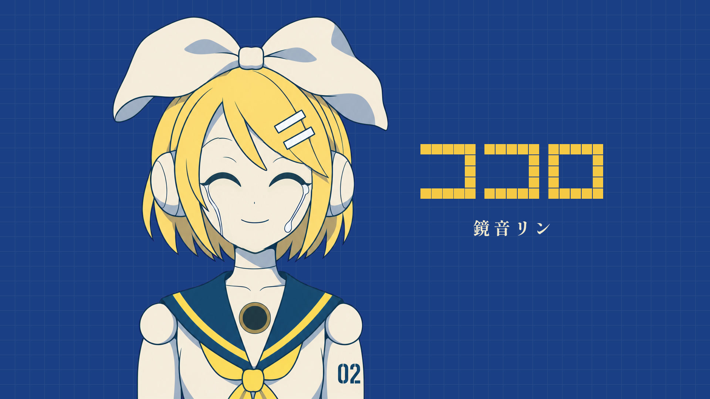
</p>

<h1 align="center">Fable5.2-Kokoro</h1>

<p align="center">
  <b>A fan PV for "Kokoro" (ココロ) · The 「心」 Design Record</b><br>
  He spent his life trying to make a heart, and every record was stamped 失敗 (failure). 180,000 days later, she stamped it 成功 (success).
</p>

<p align="center"><a href="README.md">中文</a> · English</p>

<p align="center">
  
  
  
  
  
</p>

<p align="center">
  Song: words &amp; music by <b>Toraboruta (トラボルタ)</b> · vocals <b>Kagamine Rin (鏡音リン)</b><br>
  PV by <b>RepressedAlliance (压抑同盟)</b> × <b>Claude Code</b> × <b>Codex</b>
</p>

---

## The film

<table>
  <tr>
    <td width="33%">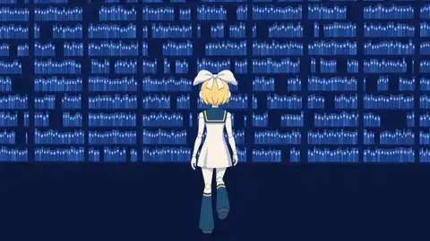</td>
    <td width="33%">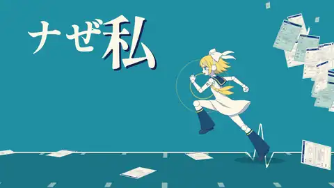</td>
    <td width="33%">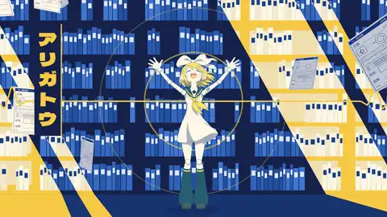</td>
  </tr>
  <tr>
    <td align="center"><sub>Walk: eight drawings, one step a beat</sub></td>
    <td align="center"><sub>Run: footfalls on the kick</sub></td>
    <td align="center"><sub>Wind: the body still, only the wind moves</sub></td>
  </tr>
  <tr>
    <td width="33%">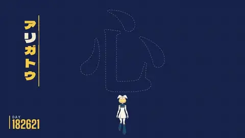</td>
    <td width="33%"></td>
    <td width="33%">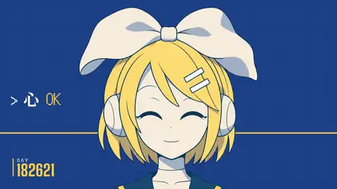</td>
  </tr>
  <tr>
    <td align="center"><sub>心: written stroke by stroke by her voice</sub></td>
    <td align="center"><sub>Overflow: memories that never cross her face</sub></td>
    <td align="center"><sub>The last seconds: ten drawn frames of a tear</sub></td>
  </tr>
</table>

**▶ Watch the full PV:** bilibili <!-- BILIBILI_URL --> · YouTube <!-- YOUTUBE_URL --> · 4:40 · 1920 × 1080 · 24 fps

The animations are silent excerpts of the film.

## What it is about

A scientist builds an android girl, ties a bow on her head and teaches her to smile. She can learn everything except one thing: a heart (「心」). Every day he draws a new design for it, and every one is stamped 失敗, from boyhood to white hair, until all that is left in the lab is an empty stool.

Centuries later she walks into the wall of his records, volume by volume, and finds his last design: the result box is empty. Then she begins to understand what all those days were.

The whole film is that design record: every frame is first a page of it - blueprint, forms, numbers, stamps, the day count - and the characters and the lyrics are things on that page.

## Where to start if you want to learn from it

| You want to know | Start here (in Chinese) |
|---|---|
| How the walk, the run, the hair in the wind and the final tear were drawn and played | [Continuous motion](docs/连贯动作.md) → [wind-loop prompts](tools/w1_wind_prompts.py) → [`windFrame()`](web/pages/kit.js) |
| How each character of the lyrics lands exactly when it is sung; the layouts | [Lyric motion](docs/歌词动效.md) → [`column()` / `row()` in kit.js](web/pages/kit.js) |
| Why hundreds of character drawings stay on model and almost never go wrong | [Character art that does not go wrong](docs/人物图怎么不出错.md) → [Prompts](docs/提示词.md) → [model sheets](art/canon/) |
| Writing 心 with her voice; photographs pouring out of her chest | [Writing 心 with her voice](docs/歌声写成心.md) · [Memories overflowing](docs/记忆涌出.md) |
| Putting swaps and cuts on the beat, and checking it | [On the beat](docs/按拍对点.md) |
| Install, render a frame, assemble the film | [Production pipeline](docs/制作流程.md) |
| The mistakes we made | [Pitfalls](docs/踩过的坑.md) |
| What is and is not in this repository | [NOTICE](NOTICE.md) · [input/README](input/README.md) |

The documentation is written in Chinese; the code comments are in English. Index: [docs/README.md](docs/README.md).

## Stills

<table>
  <tr>
    <td width="33%">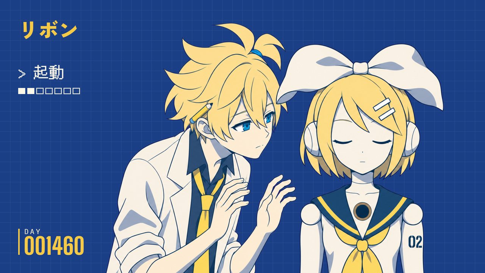</td>
    <td width="33%">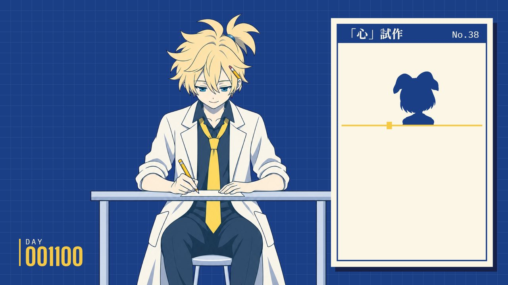</td>
    <td width="33%">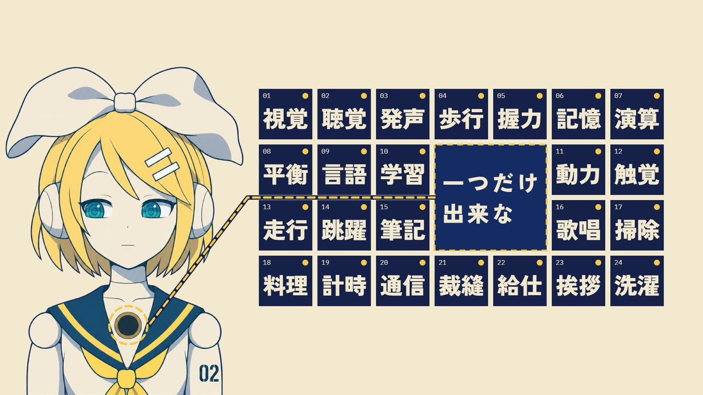</td>
  </tr>
  <tr>
    <td width="33%">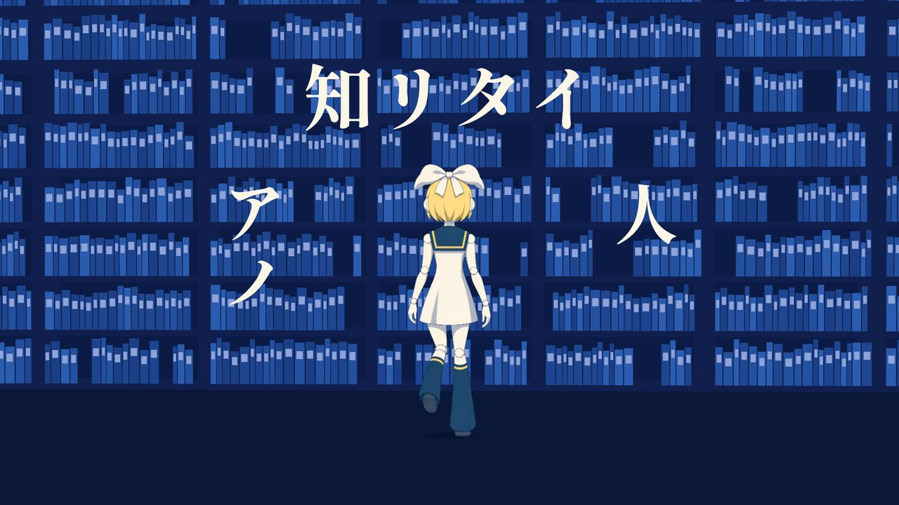</td>
    <td width="33%">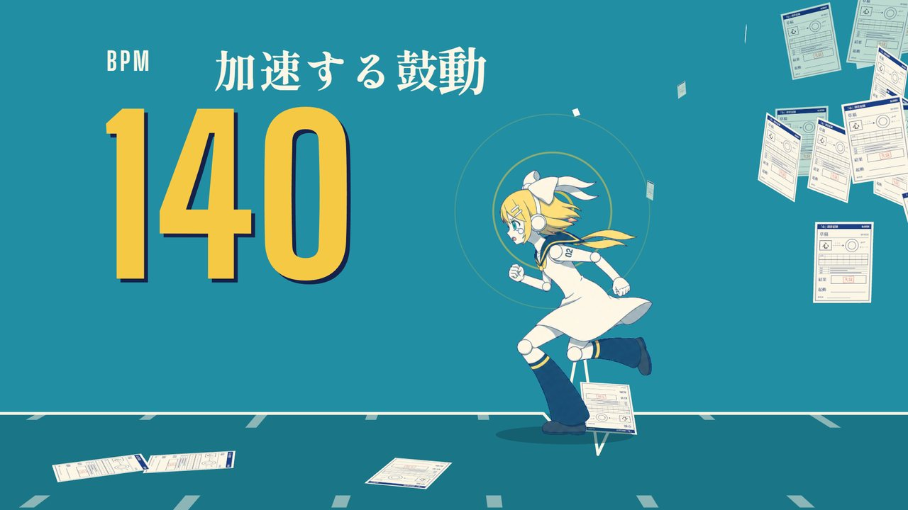</td>
    <td width="33%">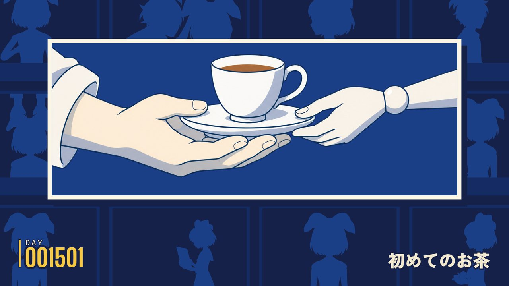</td>
  </tr>
  <tr>
    <td width="33%">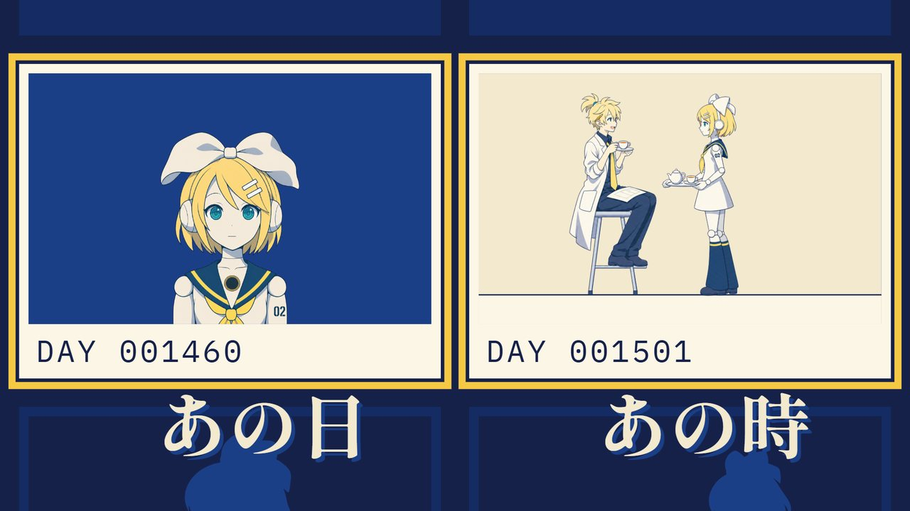</td>
    <td width="33%">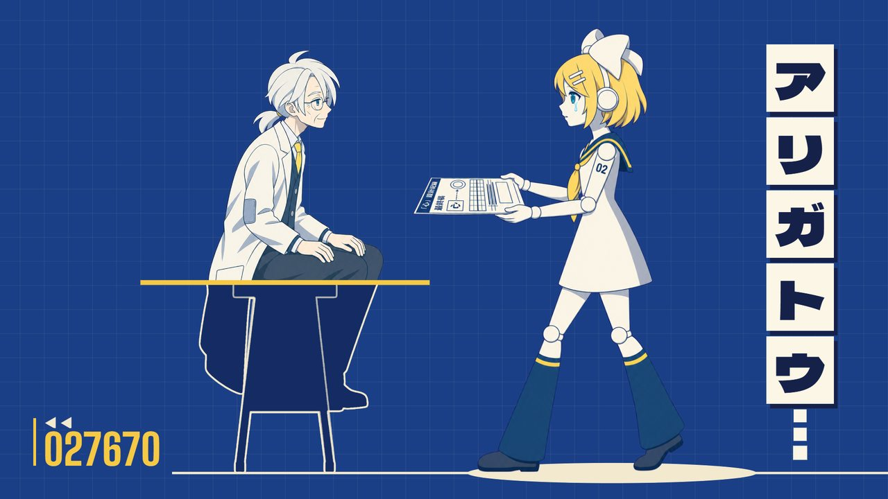</td>
    <td width="33%">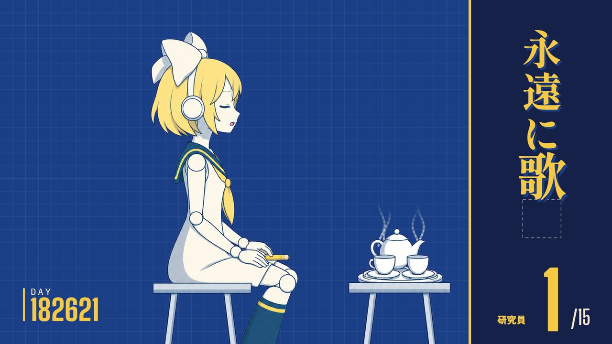</td>
  </tr>
</table>

## How the picture was made

- **The characters are cards drawn one by one by Codex.** Model sheets come first (the characters, the stool, the desk, the report); every card is generated **as one whole picture** with the sheets attached, never pasted together afterwards; the drawings of a set are the same master redrawn with one thing changed; every drawing is checked by gpt-6-astra looking at the single original image. The film loads 244 cards.
- **Motion is drawn frames.** The walk and the run are eight-drawing cycles (keys and in-betweens), the wind is eight phases redrawn from one master, the tear is ten drawings each redrawn from the one before. Code only aligns them and swaps them on the beat; it never warps or jiggles a drawing.
- **The picture is 11 designed pages.** Each passage of the song is a canvas page (`web/pages/*.js`) whose layout, camera and type are code; where depth is needed, three.js stands the cards in a 3D space. One flat palette for everything.
- **Everything runs on the song's clock.** Beat grid 20.016 + k × 0.42858 s; swaps, cuts, stamps and characters land on beats or half-beats, the picture one frame ahead of the sound; the time of every sung character is measured on the separated voice.
- **Audits and reviews.** Capturing records which cards every frame draws, and flags swaps held less than two beats and A→B→A; the finished film is measured again for picture changes against the beat; Opus subagents and gpt-6-astra review separately, and every finding is checked against the frame.

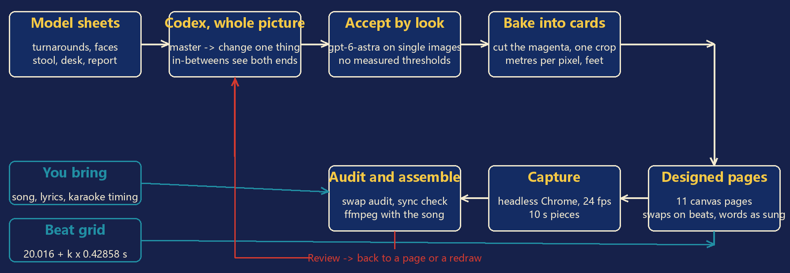

## Parts you can take

| Part | How | Code |
|---|---|---|
| Drawn loops | Redraw the master changing one thing; in-betweens see both neighbours; one uniform scale + shift; frames picked by the song's clock | [tools/w1_wind_prompts.py](tools/w1_wind_prompts.py), [tools/w1_align.py](tools/w1_align.py), [web/pages/kit.js](web/pages/kit.js) |
| A tear, frame by frame | Each frame redrawn from the previous one; only what changed on the face is taken from the new drawing | [tools/w2_endt.py](tools/w2_endt.py), [web/pages/outro.js](web/pages/outro.js) |
| Character-by-character lyrics | Lands when sung, with a small overshoot; small kana and brackets in vertical text; measure before placing | [web/pages/kit.js](web/pages/kit.js), [src/lyric_timing.py](src/lyric_timing.py) |
| Baking cards | Cut the magenta; one crop per set; metres per pixel, feet and ground contacts in JSON | [src/bake_v2.py](src/bake_v2.py), [src/matte.py](src/matte.py) |
| Writing with her voice | Write each stroke by distance along its shape, light it on sung syllables, and send small ラ into her chest | [web/pages/finale_ra.js](web/pages/finale_ra.js) |
| Flying paper that never hides the face | Compute each whole flight first; if it would cross the face, send it behind her | [web/pages/verse2_overflow.js](web/pages/verse2_overflow.js) |
| Headless rendering | A Chrome of its own per run; timeouts, retries, clean-up by profile folder | [tools/render.mjs](tools/render.mjs), [tools/capture_all.py](tools/capture_all.py) |
| Swap audit | Hook drawImage and three.js, record the cards of every frame, check hold times and A→B→A | [tools/audit_swaps_probe.js](tools/audit_swaps_probe.js), [tools/audit_swaps.py](tools/audit_swaps.py) |
| Beat grid | Spectral flux + comb filter for the tempo, fine scan of period and phase | [tools/beat_grid.py](tools/beat_grid.py), [tools/sync_check.py](tools/sync_check.py) |
| An AI that looks at pictures | Codex in a read-only sandbox calling gpt-6-astra: "do not measure, report what looks wrong" | [tools/codex_review.ps1](tools/codex_review.ps1), [tools/astra_look.md](tools/astra_look.md) |

## Reading or re-running

**To study the methods, just read the docs and the code: nothing needs installing.**

To render: Windows, Python 3.12, Node.js 22+, Chrome; FFmpeg to assemble; the Codex CLI to generate or review drawings.

```powershell
git clone https://github.com/RepressedAlliance/Fable5.2-Kokoro.git
cd Fable5.2-Kokoro
py -3.12 -m venv .venv
.venv\Scripts\python -m pip install -r requirements.txt
.venv\Scripts\python tools\fetch_fonts.py
```

Bring your own song and lyrics ([input/README.md](input/README.md)). With `input/lyrics_lines.txt` in place:

```powershell
python src\apply_lyrics.py                       # lyrics + timing -> web/data/lyrics.json
python web\serve.py                              # in another terminal, keep it running
node tools\render.mjs "page=know&t=2"            # -> frames/know_t2_00.png
```

Whole pages, assembly and checks: [Production pipeline](docs/制作流程.md). This project is made for one song: the pages, beat numbers and card names belong to "Kokoro". **Another song needs its own beat grid, lyric timing and page design**; what carries over is the methods and the tools.

## Layout

```text
Fable5.2-Kokoro/
├── README.md / README.en.md     the film and where to start
├── NOTICE.md  LICENSE           rights and licences
├── requirements.txt             Python dependencies
├── web/
│   ├── page.html  serve.py      page shell (fonts; still / capture / play) and the local server
│   ├── pages/                   11 pages + kit.js (shared) + the shared stage, roll and report
│   ├── vendor/three.module.js   three.js r170
│   └── data/                    cards/ (244 cards + v2.json), lyrics_timing.json (times only)
├── src/                         baking, matting, lyric timing, lyric merge, film assembly
├── tools/                       rendering, capture, audits, beat grid, generation and review, prompt scripts
├── art/
│   ├── canon/                   model sheets: characters, stool, desk, report
│   └── v2/sets.json             card set definitions (for baking)
├── docs/                        how it was made (each piece stands alone) + images/
├── input/                       your own song and lyrics, not distributed
├── assets/fonts/                fonts (downloaded by a script, not committed)
└── frames/                      render output (not committed)
```

## Notes from making it

- **Model sheets matter more than ever-longer prompts.** Characters need them, and so do props: a stool without a sheet is a different stool in every drawing.
- **One picture, drawn in one go.** Pixels pasted together afterwards leave jagged edges, leftover background and feet facing the wrong way; "the same stool" comes from the reference, not from identical pixels.
- **Accept by eye, not by measurement.** Numbers reject good drawings and pass strange ones; have another pair of eyes look at the single original image - and check what it says.
- **Motion has to be drawn.** Two drawings swapped back and forth is a jitter; too timid a move is no move. Four phases with in-betweens, played on the beat.
- **Turn what you learn into tools.** The swap audit, the sync check, the render timeouts and clean-up all came out of rework.

More in [Pitfalls](docs/踩过的坑.md).

## Credits and licence

- **PV:** RepressedAlliance (direction, review, image-by-image checks and feedback) × Claude Code (Claude Fable 5.2 as director: concept, storyboard, assigning and accepting the work; Opus subagents: page code, image generation and baking, independent reviews) × Codex (character drawings generated from the model sheets; gpt-6-astra for acceptance by eye).
- **Song:** "Kokoro" (ココロ), words, music and arrangement by Toraboruta, sung by Kagamine Rin (2008).
- **Characters:** Kagamine Rin and Kagamine Len © Crypton Future Media, INC. (the scientist follows the common fan depiction of Len and is never named in the film). Use of the character art is subject to the [Piapro Character License](https://piapro.net/intl/license.html).
- **Character art:** generated with an OpenAI image model through the Codex CLI from the model sheets in `art/canon/` and the prompts in `tools/`, then processed by `src/bake_v2.py`.
- **Fonts:** SIL Open Font License fonts from Google Fonts, downloaded by a script, not bundled. three.js (MIT) is included.
- **Licence:** code [MIT](LICENSE); images (character cards, model sheets, stills, animations) and documentation **CC BY-NC 4.0**. See [NOTICE.md](NOTICE.md).
- **Project name:** kept as published; the division of work follows the production records, and the repository name is not proof of any model's identity.

The song's audio, the lyric text, karaoke timing and the finished video are not in this repository. This is an independent, unofficial fan work.
