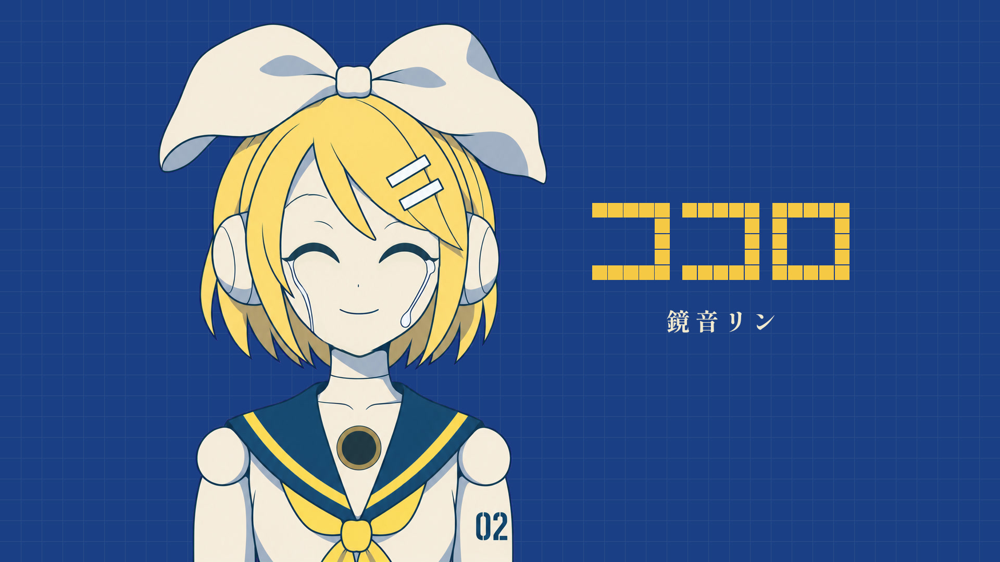
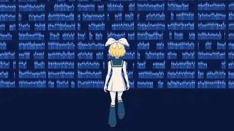
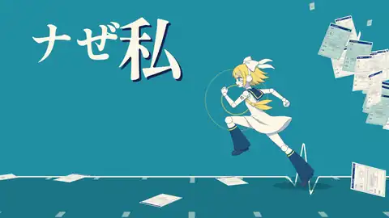
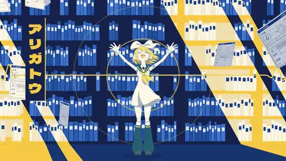
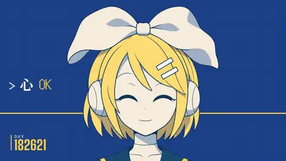
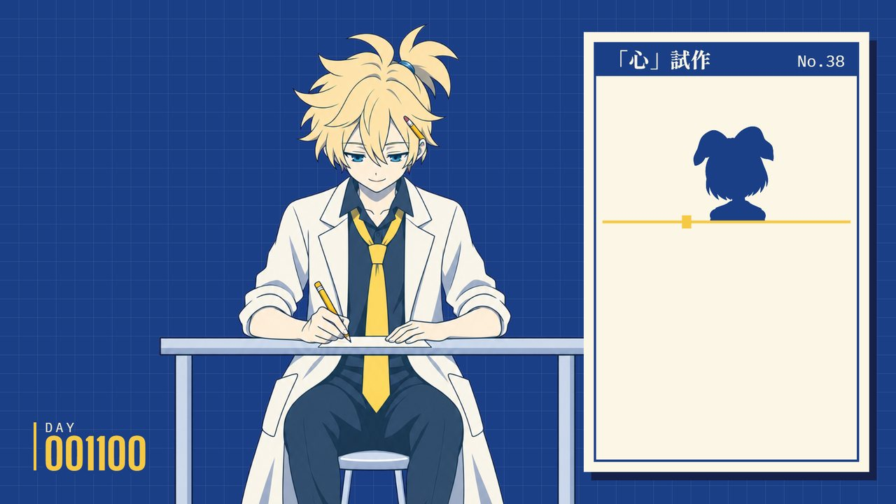
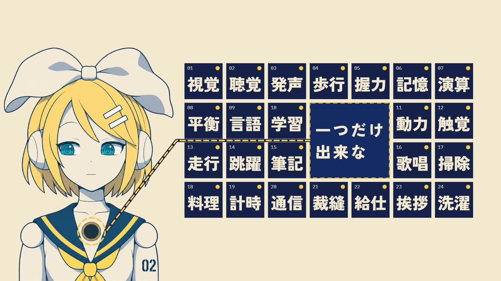
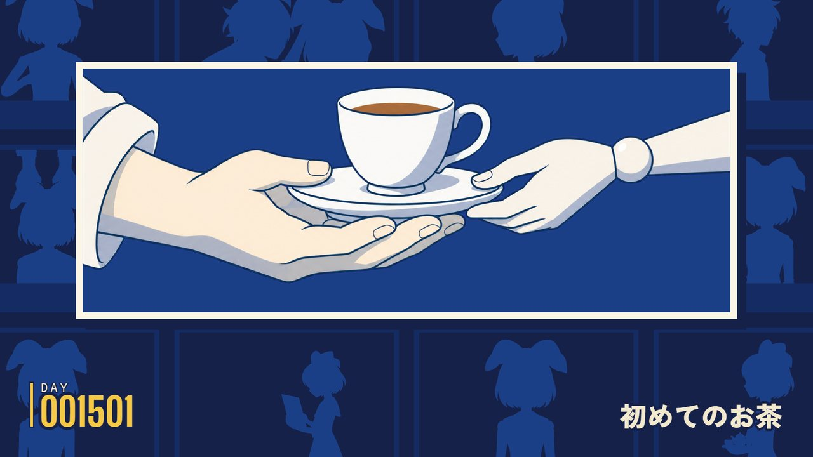
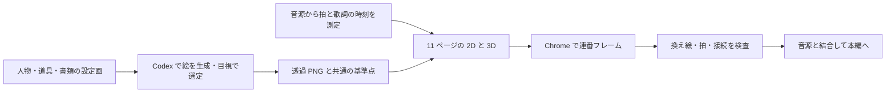

  

<h1 align="center">ココロ · 「心」の設計記録</h1>

  <b>トラボルタ『ココロ』のファンメイド PV</b> 
  心を作るための生涯の記録には、いつも「失敗」の印があった。18 万日後、彼女は「成功」の印を押す。

<a href="README.md">简体中文</a> · <a href="README.en.md">English</a> · 日本語

  作詞・作曲・編曲 <b>トラボルタ</b> · 歌 <b>鏡音リン</b> 
  PV <b>RepressedAlliance × Claude Code × Codex</b>

## 本編

<table>
  <tr>
    <td width="33%"></td>
    <td width="33%"></td>
    <td width="33%"></td>
  </tr>
  <tr>
    <td align="center">歩き：八枚の絵で一拍に一歩</td>
    <td align="center">走り：キックに合わせて着地</td>
    <td align="center">風：髪、リボン、裾のループ</td>
  </tr>
  <tr>
    <td width="33%"></td>
    <td width="33%"></td>
    <td width="33%"></td>
  </tr>
  <tr>
    <td align="center">心：歌で一筆ずつ書く</td>
    <td align="center">記憶：顔を隠さずに飛ぶ写真</td>
    <td align="center">終幕：十枚で描いた涙</td>
  </tr>
</table>

[bilibili で見る](https://www.bilibili.com/video/BV1f3sn6QEc5/) · [YouTube で見る](https://youtu.be/O-Xq1JkeVvg) · 4:40 · 1920×1080 · 24 fps

<table>
  <tr>
    <td width="33%"></td>
    <td width="33%"></td>
    <td width="33%"></td>
  </tr>
  <tr>
    <td align="center">設計する</td>
    <td align="center">一つだけ空いている欄</td>
    <td align="center">湯飲みを渡す手</td>
  </tr>
</table>

## 物語

科学者はアンドロイドの少女を作り、リボンを結び、笑い方を教えます。彼女に足りないのは「心」。少年の頃から年老いるまで描き続けた設計には、毎日「失敗」の印が増えていきます。長い時を経た彼女は、記録の壁の奥で、結果欄だけが空白の最後の設計図を見つけます。設計図、日数、試験欄、印章を、そのまま全編の画面構成に使いました。

## 制作資料

| 知りたいこと | 読む場所 |
|---|---|
| 人物と小道具をそろえ、絵を透過素材にする | [設定画から素材へ](docs/guide.ja.md#設定画から素材へ) |
| 歩き、走り、風と涙を連続した動きにする | [人物の動き](docs/guide.ja.md#人物の動き) |
| 拍を測り、歌詞を一文字ずつ表示する | [拍と歌詞](docs/guide.ja.md#拍と歌詞) |
| 声で「心」を書き、写真を立体的に飛ばす | [二つの終盤演出](docs/guide.ja.md#二つの終盤演出) |
| 環境、プレビュー、全編の結合 | [環境と書き出し](docs/guide.ja.md#環境と書き出し) |
| 試写で直したことと点検方法 | [試写とチェック](docs/guide.ja.md#試写とチェック) |

## 制作の流れ

`web/pages/` の各ページは時刻を渡すと特定のフレームを描きます。Canvas 2D で紙面、文字、図形を描き、奥行きが必要な場面は three.js の空間に人物や紙のカードを置きます。文字組み、カードの描画、日数、印章、風のループ、拍の換算は `kit.js` にまとめています。

## 収録内容とクレジット

- RepressedAlliance は演出・試写・素材確認。Claude Code では Claude Fable 5.2 が構成・絵コンテ・制作の取りまとめ、Opus のサブエージェントがページ実装や確認を担当。Codex で原画を作り、gpt-6-astra を画像の目視確認にも使用しました。担当の区分は制作記録に基づきます。
- 鏡音リン・鏡音レン © Crypton Future Media, INC.。科学者はファン作品でよく見られるレンのイメージをもとにしており、作中に名前は出ません。[ピアプロ・キャラクター・ライセンス](https://piapro.net/intl/license.html)
- ソースコードは [MIT](LICENSE)、設定画・人物素材・場面画像・制作文書は [CC BY-NC 4.0](https://creativecommons.org/licenses/by-nc/4.0/)。同梱の three.js は MIT、取得用フォントはそれぞれの SIL OFL に従います。
- 採用した 244 枚の透過カードと設定画を同梱しています。実行時には音源と歌詞を手元で用意します。[収録内容と利用条件](docs/guide.ja.md#収録内容と利用条件)
