<p align="center">
  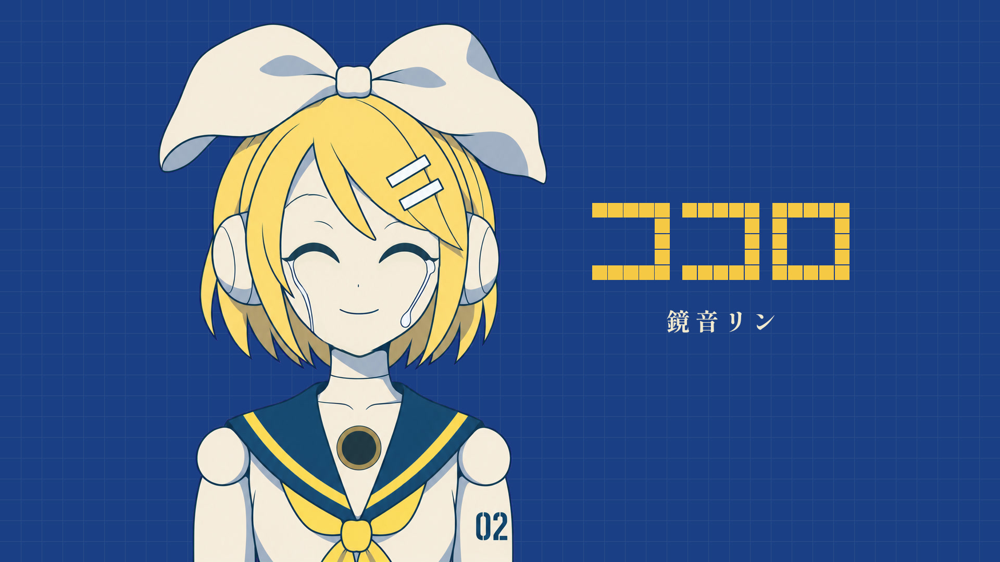
</p>

<h1 align="center">Fable5.2-Kokoro</h1>

<p align="center">
  <b>《ココロ》同人 PV · 「心」設計記録</b><br>
  他做了一辈子「心」，每一份记录都盖着「失敗」。十八万天以后，她替他盖上了「成功」。
</p>

<p align="center">简体中文 · <a href="README.en.md">English</a> · <a href="README.ja.md">日本語</a></p>

<p align="center">
  
  
  
  
  
</p>

<p align="center">
  原曲／作词作曲 <b>トラボルタ</b> · 演唱 <b>鏡音リン</b><br>
  PV <b>压抑同盟 RepressedAlliance</b> × <b>Claude Code</b> × <b>Codex</b>
</p>

---

## 成片

<table>
  <tr>
    <td width="33%">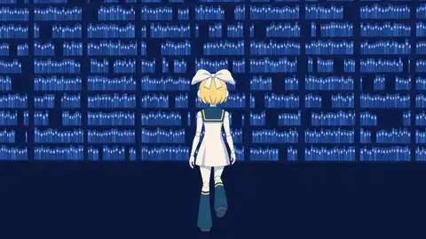</td>
    <td width="33%"></td>
    <td width="33%">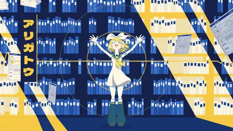</td>
  </tr>
  <tr>
    <td align="center"><sub>走：八帧循环，一拍一步</sub></td>
    <td align="center"><sub>跑：落脚踩在鼓点上</sub></td>
    <td align="center"><sub>风：身体不动，只有风在动</sub></td>
  </tr>
  <tr>
    <td width="33%"></td>
    <td width="33%">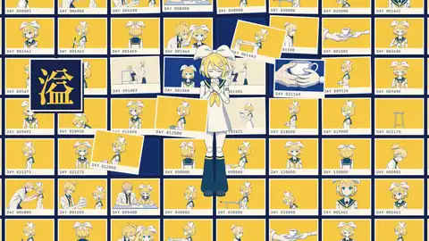</td>
    <td width="33%">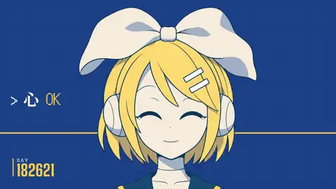</td>
  </tr>
  <tr>
    <td align="center"><sub>心：歌声逐笔写成「心」</sub></td>
    <td align="center"><sub>溢れ出す：记忆涌出，不挡她的脸</sub></td>
    <td align="center"><sub>最后几秒：十张画出来的泪</sub></td>
  </tr>
</table>

**看完整 PV** · [哔哩哔哩](https://www.bilibili.com/video/BV1f3sn6QEc5/) · [YouTube](https://youtu.be/O-Xq1JkeVvg) · 4 分 40 秒 · 1920 × 1080 · 24 fps

动图是成片的无声片段。

## 这支片子讲什么

一位科学家造了一个机器人少女，给她系上蝴蝶结，教她笑。她什么都学得会，只有一样做不出来：「心」。他每天画一张设计图，每一张都盖上「失敗」，从少年画到白发，直到实验室里只剩一张空凳子。

几百年后，她走进那一整面墙的记录，一卷一卷看下去，找到他最后一张设计稿：结果栏是空的。然后，她开始明白那些日子是什么。

全片是那本「心」設計記録：每一个画面先是一页记录——蓝图、表格、编号、印章、天数——人物和歌词都是这页上的东西。

## 想参考制作过程，从这里开始

| 你想了解 | 建议入口 |
|---|---|
| 走路、奔跑、风吹头发、结尾的泪，这些连贯动作是怎么画、怎么播的 | [连贯动作](docs/连贯动作.md) → [风循环的提示词](tools/w1_wind_prompts.py) → [`windFrame()`](web/pages/kit.js) |
| 歌词怎么做到唱到哪个字、哪个字落下；几种版式 | [歌词动效](docs/歌词动效.md) → [`kit.js` 的 `column()` / `row()`](web/pages/kit.js) |
| 人物图为什么几乎不出错、几百张还是同一个人 | [人物图怎么不出错](docs/人物图怎么不出错.md) → [提示词](docs/提示词.md) → [设定图](art/canon/) |
| 歌声写成「心」、照片从胸口涌出 | [歌声写成心](docs/歌声写成心.md) · [记忆涌出](docs/记忆涌出.md) |
| 换张、切镜怎么卡在拍上；怎么检查 | [按拍对点](docs/按拍对点.md) |
| 安装、渲染一帧、整片合成 | [制作流程](docs/制作流程.md) |
| 我们犯过哪些错 | [踩过的坑](docs/踩过的坑.md) |
| 仓库里有什么、没有什么 | [NOTICE](NOTICE.md) · [input/README](input/README.md) |

完整索引见 [docs/README.md](docs/README.md)。

## 画面

<table>
  <tr>
    <td width="33%">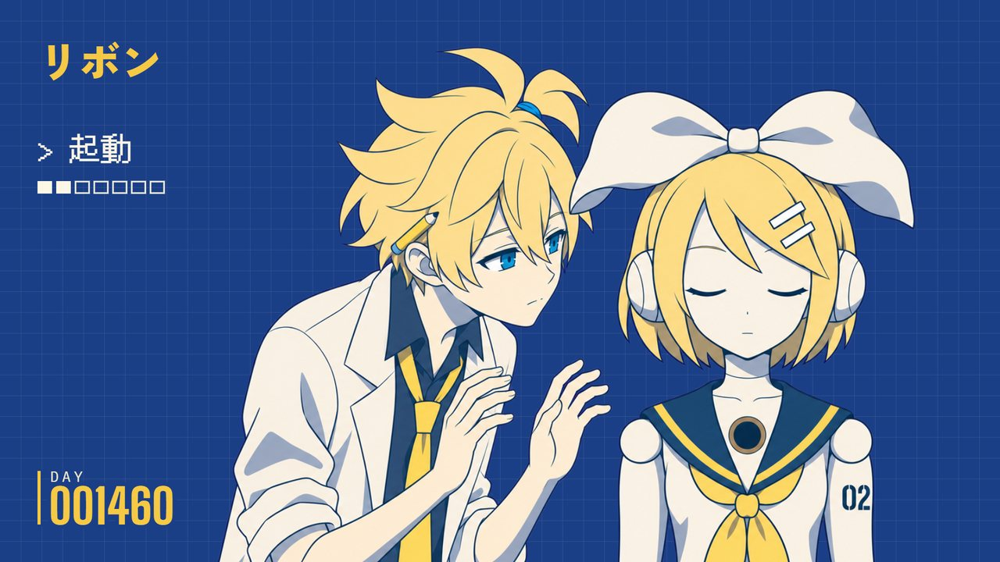</td>
    <td width="33%">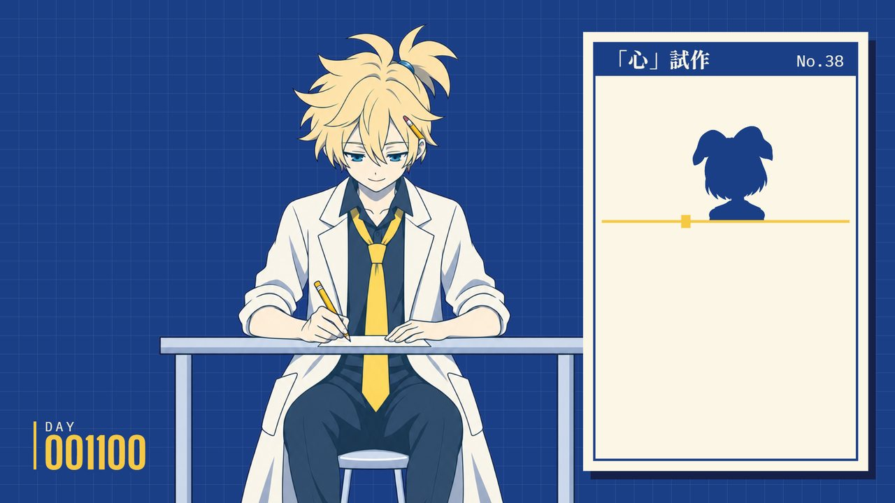</td>
    <td width="33%">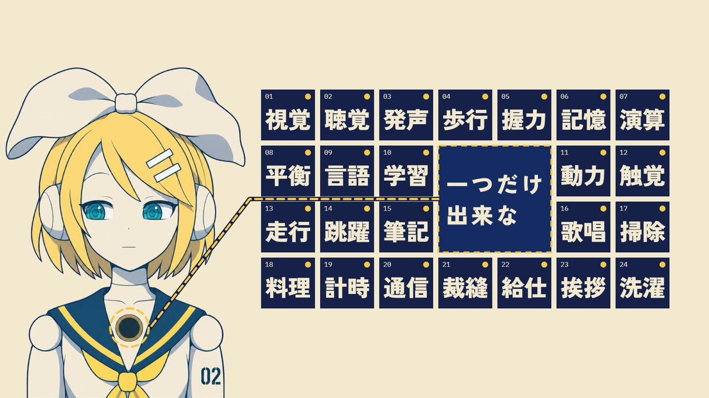</td>
  </tr>
  <tr>
    <td width="33%">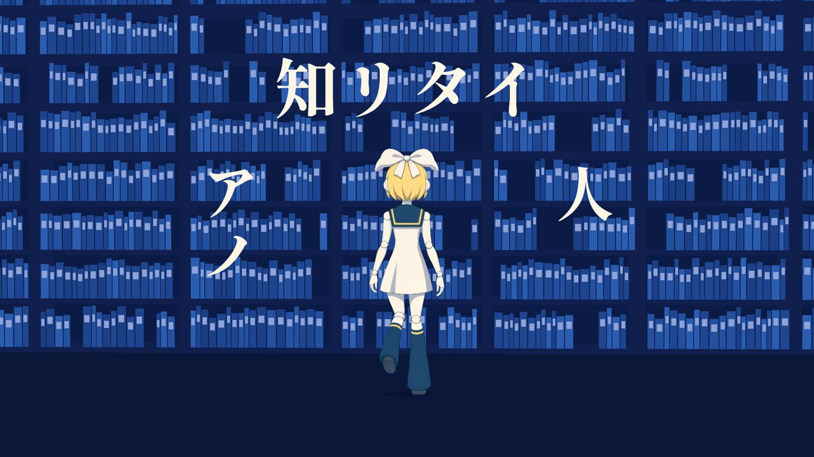</td>
    <td width="33%">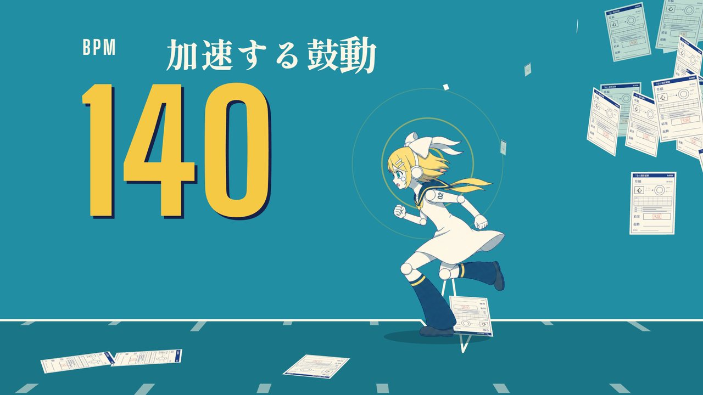</td>
    <td width="33%"></td>
  </tr>
  <tr>
    <td width="33%">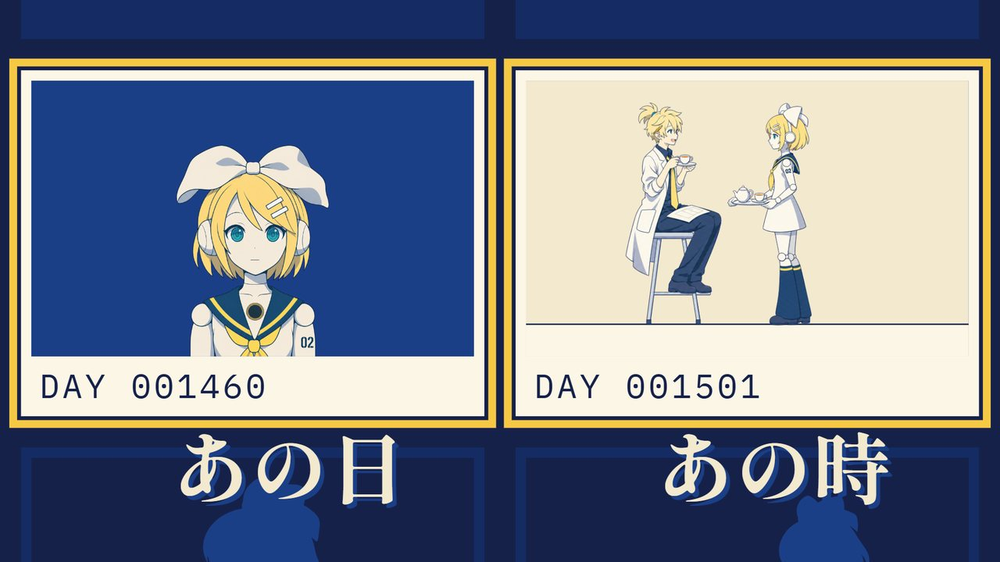</td>
    <td width="33%">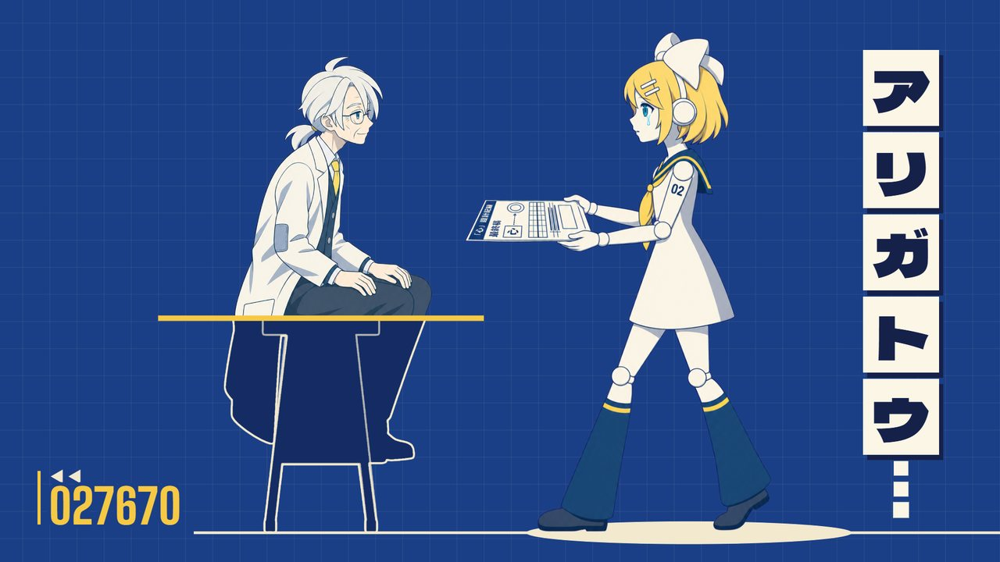</td>
    <td width="33%">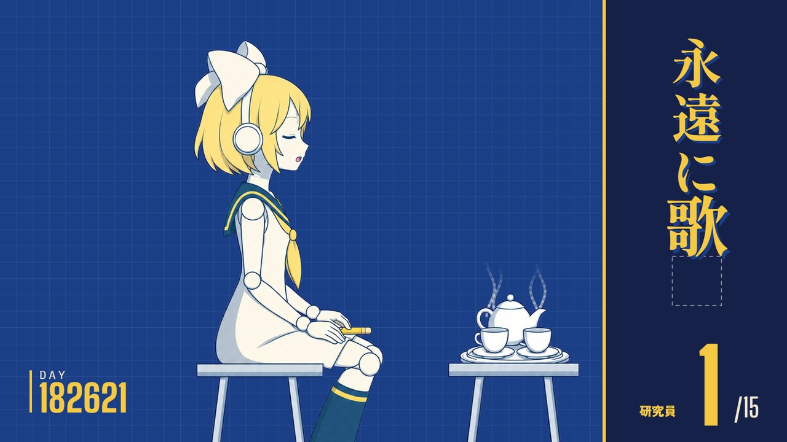</td>
  </tr>
</table>

## 画面是怎样做出来的

- **人物是 Codex 一张张画出来的卡片。** 先画设定图（人物、凳子、桌子、报告），每张卡都带着设定图**一次整张生成**，不事后拼贴；同一组的图用同一张母版原样重画、只改一处；每张图都让 gpt-6-astra 看单张原图验收。片中加载 244 张卡片。
- **动作是画出来的帧。** 走路、奔跑是八帧循环（关键张 + 中间张），风吹头发是同一张母版画出的八个相位，结尾的泪是十张逐帧重画的图。代码只负责对齐和按拍换张，不扭曲、不抖动一张图。
- **画面是 11 个设计过的页面。** 每一段歌是一个 canvas 页面（`web/pages/*.js`），版面、镜头、字都由代码排；需要纵深的段落用 three.js 把卡片立在三维空间里。颜色只有一套平涂色板。
- **一切按歌的时钟走。** 拍点网格 20.016 + k × 0.42858 秒；换张、切镜、盖章、出字都落在拍或半拍上，画面比声音早一帧；每个字的时间在分离出来的人声上量过。
- **审计和审片。** 截帧时记录每一帧画了哪些卡，自动查出停不满两拍的换张和 A→B→A；成片再量一遍画面变化是不是落在拍上；Opus 子代理和 gpt-6-astra 分头审片，结论都要对着画面核实。

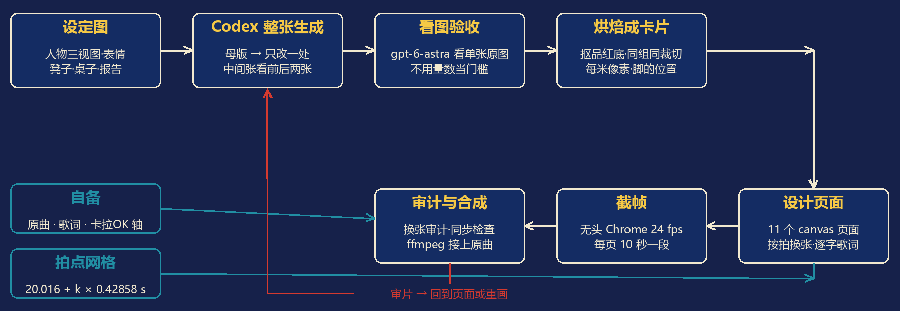

<details>
<summary>查看可编辑的 Mermaid 流程图</summary>

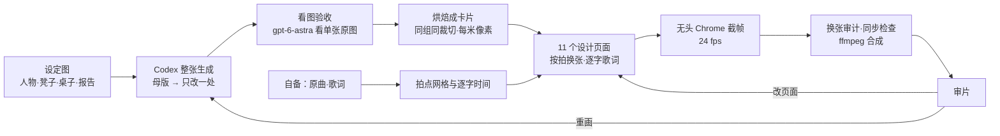

</details>

## 可以单独参考的部分

| 部分 | 做法 | 代码 |
|---|---|---|
| 画出来的循环 | 母版原样重画只改一处；中间张参考前后两张；统一缩放平移对齐；按拍取帧 | [tools/w1_wind_prompts.py](tools/w1_wind_prompts.py)、[tools/w1_align.py](tools/w1_align.py)、[web/pages/kit.js](web/pages/kit.js) |
| 逐帧的泪 | 每帧以上一帧为底重画，只把脸上变了的地方换成新图 | [tools/w2_endt.py](tools/w2_endt.py)、[web/pages/outro.js](web/pages/outro.js) |
| 逐字歌词 | 唱到才落、落下时弹一下；竖排的小假名和括号；先量再放 | [web/pages/kit.js](web/pages/kit.js)、[src/lyric_timing.py](src/lyric_timing.py) |
| 烘焙卡片 | 抠品红底；一组一个裁切框；每米像素、脚的位置、着地点写进 JSON | [src/bake_v2.py](src/bake_v2.py)、[src/matte.py](src/matte.py) |
| 歌声写字 | 按笔画内的测地距离写字，跟唱音点亮，再化作「ラ」流入身体 | [web/pages/finale_ra.js](web/pages/finale_ra.js) |
| 不挡脸的飞纸 | 先算完整条轨迹，会碰到脸就改从身后走 | [web/pages/verse2_overflow.js](web/pages/verse2_overflow.js) |
| 无头渲染 | 每次独立的 Chrome，超时、重试、按用户目录清理进程 | [tools/render.mjs](tools/render.mjs)、[tools/capture_all.py](tools/capture_all.py) |
| 换张审计 | 拦截 drawImage 和 three.js，记录每帧画了哪些卡，查停留时长和 A→B→A | [tools/audit_swaps_probe.js](tools/audit_swaps_probe.js)、[tools/audit_swaps.py](tools/audit_swaps.py) |
| 拍点网格 | 频谱通量 + 梳状滤波定速度，细扫周期和相位 | [tools/beat_grid.py](tools/beat_grid.py)、[tools/sync_check.py](tools/sync_check.py) |
| 让 AI 看图 | Codex 只读沙箱调用 gpt-6-astra，“不要量，只报看着不对的” | [tools/codex_review.ps1](tools/codex_review.ps1)、[tools/astra_look.md](tools/astra_look.md) |

## 开始参考或重跑

**只想研究方法，直接读文档和代码就行，不需要装任何东西。**

要渲染画面：Windows、Python 3.12、Node.js 22 以上、Chrome；合成需要 FFmpeg；生成或审看人物图需要 Codex CLI。

```powershell
git clone https://github.com/RepressedAlliance/Fable5.2-Kokoro.git
cd Fable5.2-Kokoro
py -3.12 -m venv .venv
.venv\Scripts\python -m pip install -r requirements.txt
.venv\Scripts\python tools\fetch_fonts.py
```

原曲和歌词要自备（见 [input/README.md](input/README.md)）。放好 `input/lyrics_lines.txt` 后：

```powershell
python src\apply_lyrics.py                       # 歌词 + 时间 -> web/data/lyrics.json
python web\serve.py                              # 另开一个终端，保持运行
node tools\render.mjs "page=know&t=2"            # -> frames/know_t2_00.png
```

整页截帧、合成和检查见 [制作流程](docs/制作流程.md)。这是为一首歌定制的工程：页面、拍号和卡片名都绑在《ココロ》上，**换歌要重新量拍、对词、设计页面**，能直接拿走的是方法和工具。

## 目录

```text
Fable5.2-Kokoro/
├── README*.md                    中、英、日三语入口
├── NOTICE.md  LICENSE           权利说明与许可
├── requirements.txt             Python 依赖
├── web/
│   ├── page.html  serve.py      页面外壳（字体、单帧/整页/播放三种模式）与本地服务
│   ├── pages/                   11 个页面 + kit.js（公共函数）+ 共用的舞台、名册、报告
│   ├── vendor/three.module.js   three.js r170
│   └── data/                    cards/（244 张卡片 + v2.json）、lyrics_timing.json（只有时间）
├── src/                         烘焙卡片、抠底、歌词对时、歌词合成、整片合成
├── tools/                       渲染、截帧、审计、拍点、出图与看图、提示词脚本
├── art/
│   ├── canon/                   设定图：人物、凳子、桌子、报告
│   └── v2/sets.json             卡片组的定义（烘焙用）
├── docs/                        怎么做的（每篇独立可读）+ images/
├── input/                       自备的原曲和歌词，不随仓库分发
├── assets/fonts/                字体（脚本下载，不入库）
└── frames/                      渲染输出（不入库）
```

## 制作手记（摘要）

- **设定图比越来越长的提示词更重要。** 人物要设定图，道具也要；没有设定图的凳子，每张图都是另一把凳子。
- **一张图一次画完。** 事后拼贴的像素会留下锯齿、残色和反着的脚；“同一个”靠参考图保证，不靠逐像素相同。
- **验收看“像不像”，不看“量出来对不对”。** 量值会误杀好图、放过怪图；让另一双眼睛看单张原图，但它的结论也要核实。
- **动态要画出来。** 两张来回切是鬼畜，保守到看不出动也不行；四个相位加中间张，按拍播放。
- **有用的东西写成工具。** 换张审计、同步检查、无头渲染的超时和清理，都是一次次返工之后留下来的。

详细的见 [踩过的坑](docs/踩过的坑.md)。

## 署名与许可

- **PV：** 压抑同盟 RepressedAlliance（方向、审片、逐张看图与反馈）× Claude Code（Claude Fable 5.2 担任导演：构思、分镜、分派与验收；Opus 子代理：页面代码、出图与烘焙、独立审片）× Codex（带设定图生成人物图；gpt-6-astra 看图验收）。
- **原曲：**《ココロ》，作词作曲编曲 トラボルタ，演唱 鏡音リン（2008）。
- **角色：** 鏡音リン、鏡音レン © Crypton Future Media, INC.（科学家的造型取自同人中常见的鏡音レン形象，片中不出现名字）。使用角色图须遵守 [Piapro Character License](https://piapro.net/intl/license.html)。
- **人物图：** 由 Codex（OpenAI 图像模型）按 `art/canon/` 的设定图和 `tools/` 里的提示词生成，经 `src/bake_v2.py` 处理。
- **字体：** Google Fonts 的 SIL Open Font License 字体，由脚本下载，不打包进仓库。three.js（MIT）随仓库附带。
- **许可：** 代码 [MIT](LICENSE)；图片（人物卡片、设定图、剧照、动图）和文档 **CC BY-NC 4.0**。详见 [NOTICE.md](NOTICE.md)。
- **项目名称：** 沿用发布时的名称；分工按制作记录如实写，仓库名不作为模型身份的证明。

仓库里没有歌曲音频、歌词文本、卡拉 OK 轴和成片视频。本项目为独立、非官方的同人创作。
