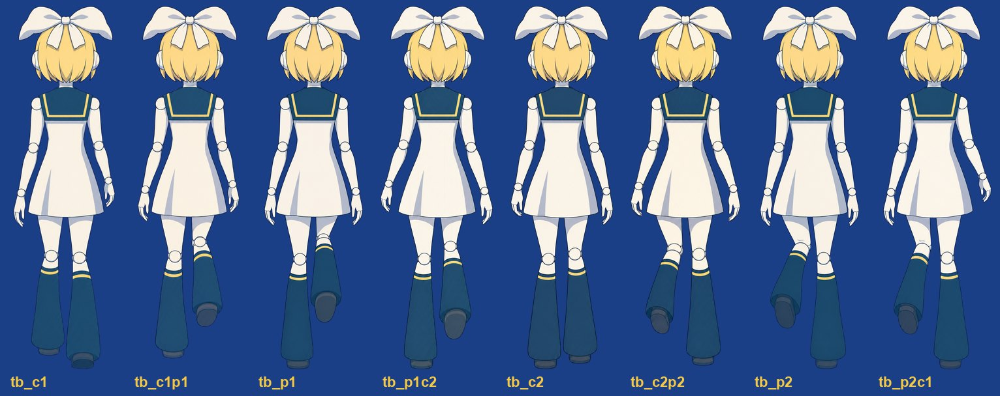

# Making Kokoro

[简体中文](README.md) · English · [日本語](guide.ja.md) · [Project home](../README.en.md)

## Pages and shot design

The whole film looks like the scientist's design record. Day counts, forms, report pages and stamps act as the sets on which the characters and lyrics perform. Ages and dates carry the long passage of time. The empty result field and the empty stool carry what changes after the scientist is gone.

| Page | What it does |
|---|---|
| `open` / `verse1` | Establish the design record, the scientist and Rin, then print her tests and diagrams into the page. |
| `ages` / `know` | Age the scientist across a single sequence, then send Rin toward the wall of records. |
| `chorus1` / `wonder` | Put her running on the kick and let the records and paper forms fill the space. |
| `verse2` / `say` | Show the memories at scale. At the overflow, photographs leave the wall and then burst back out from her chest. |
| `thanks` / `finale` / `outro` | Let the voice draw the final heart, move from the record to her expression, and end with the tear and the stamp. |

There are 11 page modules in [web/pages](../web/pages/), from `open` to `outro`. Each exports `name`, `start`, `duration`, `prepare()` and `draw(c,t)`. The frame depends on time instead of how long the tab has been running, so it can be rendered out of order. Most pages are drawn in Canvas 2D. `chorus1`, `know` and parts of `finale` use a shared three.js stage with flat figures in depth. [kit.js](../web/pages/kit.js) shares the palette, song clock, figures, stamps and type.

## Reference sheets and finished cards

Make a reference sheet before drawing each character and recurring prop. Use Rin's front, turn and back; the scientist's three ages; and sheets for the stool, desk and failure/success report. Attach the relevant ones to a short shot instruction. The attached images fix proportions, silhouette and paper layout. Plain directional lighting, two-tone colour and simple hands make the art hold at large sizes. [Reference sheets](../art/canon/) · [Production prompt examples](../tools/w1_wind_prompts.py)

Review the singular full drawing before baking. Set it against the actual dark blue background and look at the feet, proportions and traces of the magenta key colour. For an edit, ask for the same complete composition with only the expression, limb or wind phase changed. Images that blend well on a spreadsheet can still look like different characters at a cut; review the sequence too.

[matte.py](../src/matte.py) extracts alpha from magenta using `min(red, blue) - green` and removes the matte colour from edges. [bake_v2.py](../src/bake_v2.py) writes `lit_day` cards and dimensions to `web/data/cards/v2.json` from `art/v2/sets.json`. Use one crop for the entire set and retain the contact points and scale. The paper remap works on connected light-cyan regions larger than `paper_min`. Tiny cyan iris highlights and tears are protected. `keep_print` preserves thin dark lettering on paper. Bake one set at a time to protect the shared manifest, then capture pages after all bakes finish.

## Moving drawings

| Example | How it was made |
|---|---|
| Walk | Eight frames from four key poses and four in-betweens. Put the planted-foot frame on the beat, with one step per beat. [know.js](../web/pages/know.js) |
| Run | Eight frames with feet landing on the audible kick at the half beat in the first chorus. The camera's pulse starts under the planted foot. [chorus1.js](../web/pages/chorus1.js) |
| Wind | Redraw the same master for four phases, then use both neighbours as references for the four intermediate images. The body stays aligned and the tips, bow, scarf and hem move. `windFrame()` picks a phase on the song clock. [kit.js](../web/pages/kit.js) |
| Tear | Redraw each of ten stages from the previous image. Take the small region that changed so the face and background hold while the drop travels. [outro.js](../web/pages/outro.js) · [tear prompts](../tools/w2_endt.py) |



Align a set with one common scale and translation and one crop. Use the same baseline through the drawings. Reciprocating two held images tends to look like a twitch. Ordinary changes hold for two beats; drawn cycles are deliberately reviewed separately, usually at two or three frames per drawing.

## Beat and lyric timing

From [beat_grid.py](../tools/beat_grid.py), the grid is `20.016 + k × 0.42858` seconds (140 BPM). The script scores spectral flux and low-frequency kick onsets against candidate periods, then refines period and phase. The opening music box has its own measured hits. The first chorus run and much of the later vocal fall on the half beat. Check the actual audible hit before assigning a change to the whole or half beat.

Lyrics are drawn on the page. `column()` and `row()` measure before placing, reserve at least 60 px near the frame edges, and avoid the head, ribbon and other type. Columns read right to left. Kana, brackets and the long-vowel mark need vertical styling. Depending on the page, the same timing powers a column, a checklist, number counters, a strip over a photo wall or paper tiles. A syllable is legible at its onset with a small overshoot, and the final film leads the audio by one frame.

The [numeric timing table](../web/data/lyrics_timing.json) stores each character's absolute time (`t`), the reference file time (`file`), line boundaries and character count (`n`). To retime with [lyric_timing.py](../src/lyric_timing.py), separate the vocals, align the karaoke ASS offset, and search each syllable near its karaoke time for a librosa onset. The window is roughly −0.17 to +0.07 s. Where it lacks a clear onset, the script compensates by about 0.05 s. Use `lyric_syllables.txt` to map syllable counts to characters and review the printed adjustments. Repeated thank-yous and the sung syllables in the final vocal run need a separate listening pass; the original karaoke timing ended before the performance did.

## Two finale effects

**Writing the heart.** Around 3:54–4:13, [finale_ra.js](../web/pages/finale_ra.js) rasterizes 心, finds its four stroke components and reveals each stroke in order of distance along its shape. The first set of sung syllables writes the strokes. The next four light them yellow and a held note cuts to her face. Canvas `source-atop` confines small ラ glyphs to the ink. These then flow into her chest on quadratic Bézier paths. This v12 approach replaced an earlier gathering of flying paper, still available in [finale_heart.js](../web/pages/finale_heart.js).


**Memory overflow.** At around 3:08–3:12, [verse2_overflow.js](../web/pages/verse2_overflow.js) bakes each existing photo-wall cell into an off-screen texture at four resolutions. Cards have a front, paper back, hard two-level lighting and depth order. They first spiral into the ring, then burst out on the sung 出 character. Paths are evaluated before rendering. An incoming card that crosses her face goes behind her. Outgoing cards start behind her silhouette; a path that would re-enter the figure is redrawn or sent behind her. The camera pushes in for the intake and pulls out with the burst.


## Environment and rendering

Original environment: Windows 11, Python 3.12, Node.js 24, Chrome, FFmpeg 8 and PowerShell 7. The Codex CLI is only needed when generating or reviewing new drawings.

```powershell
py -3.12 -m venv .venv
.venv\Scripts\python -m pip install -r requirements.txt
.\.venv\Scripts\Activate.ps1
python tools\fetch_fonts.py
```

Put your audio at `input/kokoro.wav`. Compare `python tools\beat_grid.py input\kokoro.wav` with the original beat phase near 20.016 s; a different amount of opening silence shifts the entire timeline. `input/lyrics_lines.txt` must have 44 lines in film order. Blank lines and comments beginning with `#` are skipped. Full-width spaces count as characters. Each line must match the corresponding `n`, and the wording must match `line()` lookups in the pages. See the [placeholder format](../web/data/lyrics.example.json).

Optional retiming inputs: `input/karaoke.ass` with `{\k}` tags, `input/vocals.wav` from Demucs, `input/lyric_syllables.txt` and `input/timing.json` with `ass_offset_seconds`.

```powershell
python src\apply_lyrics.py
python web\serve.py
```

Keep the server on port 8765 running. `apply_lyrics.py` writes `web/data/lyrics.json`, required even for silent page previews. Run the next commands in a separate terminal with the same environment:

```powershell
node tools\render.mjs "page=know&t=2" "page=finale&t=15"
python tools\capture_all.py
python src\assemble_pages.py out\kokoro.mp4 18
python tools\sync_check.py out\kokoro.mp4
```

Here `t` counts seconds **from the page's start**. Still frames go to `frames/`. To change that directory, set `$env:KOKORO_FRAMES` before starting the server. Use `python tools\capture_all.py know` for a single page. The capture runs in ten-second batches with a separate headless Chrome profile, four-minute timeouts and retries. Full capture is about 6,730 PNGs. Keep the capture and assembly page tables in sync. For manual preview open `http://localhost:8765/page.html?page=know&t=2`. Set `play=1` and click the canvas to listen in the browser.

### Bake an original card set

The repository supplies the finished cards. For new art, add a set to `art/v2/sets.json` after generating and reviewing it:

```powershell
python tools\pad_ref.py art\canon\rin_front.png art\v2\raw\pad\g1_rin_front.png
pwsh -NoProfile -File tools\gen.ps1 -PromptFile my_prompt.txt -OutPath art\v2\raw\my_card_a.png -Ref art\v2\raw\pad\g1_rin_front.png
pwsh -NoProfile -File tools\codex_review.ps1 -Images art\v2\raw\my_card_a.png -PromptFile tools\astra_look.md -OutFile out\look.md
python src\bake_v2.py mygroup
```

Historical prompt scripts refer to production originals that are absent. Use them as examples or point them to your own master drawings.

## Review and pitfalls

```powershell
node tools\audit_swaps.mjs
python tools\audit_swaps.py
python tools\used_cards_sheets.py out\used 440
```

The audit records Canvas and three.js card draws for each frame, joins boxes into tracks, then reports short holds, A→B→A and four-second A→B→C→A patterns. Treat intentional animation loops as cycles and view them in motion. Check the finished edit with `sync_check.py`, which measures visual changes against the grid. Confirm every reported issue against the frame and soundtrack. A second look at the original drawing caught faults that geometry thresholds missed. Compare rendered props with their source, especially thin report text on rotated paper and cyan tears after matting.

## Included material and licences

Code is MIT; art and documentation are CC BY-NC 4.0 with the character rights described in [NOTICE](../NOTICE.md). The repo includes the 244 used baked cards, model sheets, selected prompt scripts, page source and timing numbers. Song audio, complete lyrics, third-party karaoke, full video, rejected drawings and internal review logs are absent. Replacing the song requires new timings, page design and figures. The typesetting, card processing, capture and review methods can be studied independently on GitHub.
