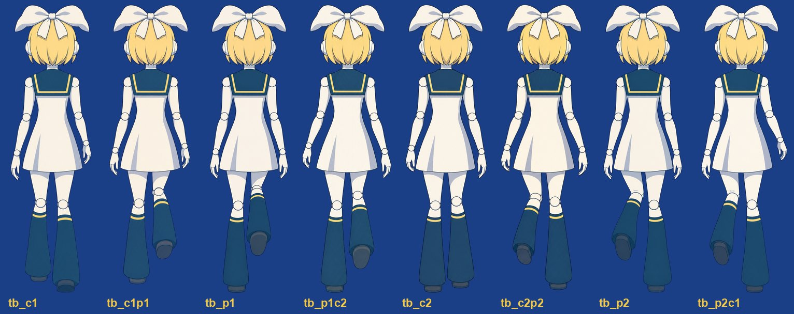

# 『ココロ』制作ガイド

[简体中文](README.md) · [English](guide.en.md) · 日本語 · [作品トップ](../README.ja.md)

## ページと構成

全編を科学者が残した心の設計記録としてデザインしました。日数、用紙、試験欄、印章が人物と歌詞を載せる舞台です。年齢と数字で長い時間を見せ、空になった椅子と空白の結果欄で彼がいなくなった後を描きます。

| ページ | 役割 |
|---|---|
| `open` / `verse1` | 設計記録、科学者、リンを紹介し、試験結果や図を紙面に出す。 |
| `ages` / `know` | 一連の絵で科学者が年を重ね、リンは記録の壁へ歩く。 |
| `chorus1` / `wonder` | キックに合わせて走る。書類や紙が画面の奥行きを満たす。 |
| `verse2` / `say` | 記憶の壁を作り、写真が壁から抜けて胸に入り、そこからあふれ出す。 |
| `thanks` / `finale` / `outro` | 声で最後の「心」を書き、表情、涙、印章で閉じる。 |

[web/pages](../web/pages/) に 11 ページあり、それぞれ `name`、`start`、`duration`、`prepare()`、`draw(c,t)` を出します。描画は渡された時刻で決まるので、好きな一枚から書き出せます。主に Canvas 2D を使い、`chorus1`、`know`、`finale` の一部で共通の three.js の空間を使います。[kit.js](../web/pages/kit.js) は色、拍、人物描画、印章、文字を共用します。

## 設定画から素材へ

リンの正面・斜め・側面・背面、科学者の三つの年齢、椅子、机、報告書を設定画にします。毎回そのショットに関係する設定画を添え、動作を短く加えて、絵を丸ごと生成します。光は素直に、影は二段階、手は形を簡潔に。差分は同じ母版を渡し、ポーズ、表情、風など変える一点だけを指示します。[設定画](../art/canon/) · [風のプロンプト例](../tools/w1_wind_prompts.py)

採用前に原画一枚を使用時の大きさと暗い青の背景で見ます。手足、輪郭、服の形、透過境界にマゼンタが残っていないか確認し、連続する絵も順に見ます。寸法は問題箇所を探す手掛かりになり、見た目の採否は絵で判断しました。

[matte.py](../src/matte.py) は `min(赤, 青) - 緑` でマゼンタ背景を抜き、縁の混色を除きます。[bake_v2.py](../src/bake_v2.py) は `art/v2/sets.json` の定義で `lit_day` の透過 PNG と `web/data/cards/v2.json` に寸法を書きます。同じ組の画は同じ切り出し枠、接地点、縮尺を使います。薄いシアンの置換は `paper_min` より広い紙の色面だけに適用し、涙や瞳の光を守ります。`keep_print` は紙に印刷された細い黒を残します。共有の寸法ファイルを守るため一組ずつ処理し、全組の処理後に書き出します。

## 人物の動き

| 動き | 作り方 |
|---|---|
| 歩き | 四枚の原画と四枚の中割り。踏んだ足を一拍に一歩で合わせる。[know.js](../web/pages/know.js) |
| 走り | 八枚。サビで耳に聞こえる半拍のキックに着地し、その場所から脈を広げる。[chorus1.js](../web/pages/chorus1.js) |
| 風 | 同じ母版から四段階を描き、前後の絵を添えて四枚の中割り。体をそろえ、毛先、リボン、襟、裾を動かす。`windFrame()` が楽曲時刻で絵を選ぶ。[kit.js](../web/pages/kit.js) |
| 涙 | 直前の絵に一か所ずつ変更を加えた十枚。涙の付近だけを新しい絵から使い、顔の残りを固定する。[outro.js](../web/pages/outro.js) · [涙のプロンプト](../tools/w2_endt.py) |



カットする範囲、縮尺、平行移動をそろえ、足の基準線を合わせます。二枚の往復は細かい振動に見えやすいため、普通の差分は二拍以上置き、描いたループだけは一枚二〜三フレームを目安に通しで確認します。

## 拍と歌詞

全体のグリッドは `20.016 + k × 0.42858` 秒（140 BPM）。[beat_grid.py](../tools/beat_grid.py) が周波数ごとの立ち上がりと低域のキックから周期を探し、位相を絞ります。オルゴールの冒頭は個別に測ります。最初のサビの着地や後半の歌は半拍が目立つ箇所があり、実際の音に合わせて整数拍と半拍を選びます。

歌詞は字幕枠に一律で載せず、紙面に書き込みます。`column()` と `row()` が文字サイズを測ってから置き、画面端に 60 px 以上の余裕を取り、顔やリボンに重ねません。縦組みは右から読み、括弧や長音記号も縦用に扱います。大きな縦書き、試験欄、写真上の帯、一枚一文字の紙、歌に連動する数字などに同じ時刻表を使います。発音時には文字が読める状態にし、合成では画面を音より一フレーム先に出しました。

[タイミング表](../web/data/lyrics_timing.json) に文字ごとの絶対秒 `t`、参照 ASS の秒 `file`、行の境界と字数 `n` を記録します。測り直す場合は、分離した歌声と ASS のずれをそろえ、[lyric_timing.py](../src/lyric_timing.py) で各音節の −0.17～+0.07 秒にある立ち上がりを探します。はっきりした立ち上がりがないときは約 0.05 秒を補正します。`lyric_syllables.txt` に各文字が使う音節数を書き、変更量を目と耳で確かめます。「アリガトウ」の繰り返しや最後の歌唱は、元のカラオケ字幕より続いていたため別に聞き取って合わせました。

## 二つの終盤演出

**声で「心」を書く。** 3:54〜4:13 頃。[finale_ra.js](../web/pages/finale_ra.js) が「心」を四つの筆画に分け、筆の通る向きに沿った距離で各画を出します。最初の組の歌声で書き、続く四音で一画ずつ黄色に変え、伸びる音で顔に切ります。`source-atop` で墨の中だけに小さな「ラ」を置き、最後は二次ベジェ曲線に沿って胸に流します。空中の紙が集まる旧案は [finale_heart.js](../web/pages/finale_heart.js) にあります。


**記憶があふれ出す。** 3:08〜3:12 頃。[verse2_overflow.js](../web/pages/verse2_overflow.js) が壁の写真を一マスずつ四段階の解像度に記録し、表、裏、二段階の光、前後順を持たせます。写真は胸の輪に吸い込まれ、「出」の発音で飛び出します。顔に掛かる軌道はあらかじめ背後に回します。飛び出す紙も輪郭から出るまでは背後に描き、また顔や体に掛かる軌道は引き直すか背後に送ります。入るときはカメラを押し、出るときは引きます。


## 環境と書き出し

制作環境は Windows 11、Python 3.12、Node.js 24、Chrome、FFmpeg 8、PowerShell 7。Codex CLI は新しい絵の生成と確認に使います。

```powershell
py -3.12 -m venv .venv
.venv\Scripts\python -m pip install -r requirements.txt
.\.venv\Scripts\Activate.ps1
python tools\fetch_fonts.py
```

音源を `input/kokoro.wav` に置き、`python tools\beat_grid.py input\kokoro.wav` の拍の位相を 20.016 秒付近と照合します。冒頭の無音が違う版は全体がずれます。`input/lyrics_lines.txt` は画面で使う順の 44 行。空行と `#` で始まるコメントは除外されます。全角空白も数え、各行が `n` と一致するようにします。ページの `line()` は文字列から行を探します。[書式の例](../web/data/lyrics.example.json)

時刻を付け直す場合、`{\k}` 付きの `input/karaoke.ass`、Demucs で分けた `input/vocals.wav`、`input/lyric_syllables.txt`、全体のずれを `ass_offset_seconds` に記入した `input/timing.json` を使います。

```powershell
python src\apply_lyrics.py
python web\serve.py
```

無音のプレビューにも `apply_lyrics.py` が作る `web/data/lyrics.json` が必要です。ポート 8765 のサーバーを立てたまま、同じ環境の別のターミナルで実行します。

```powershell
node tools\render.mjs "page=know&t=2" "page=finale&t=15"
python tools\capture_all.py
python src\assemble_pages.py out\kokoro.mp4 18
python tools\sync_check.py out\kokoro.mp4
```

`t` は**ページの先頭からの秒数**、出力先は `frames/`。保存先を変えるなら、起動前に `$env:KOKORO_FRAMES` を設定します。`python tools\capture_all.py know` で一ページだけを出せます。10 秒ごとに個別のヘッドレス Chrome で収録し、4 分の時間制限と再試行があります。本編は約 6,730 枚。収録と合成のページ表は一致させます。`http://localhost:8765/page.html?page=know&t=2` で一枚確認できます。`play=1` を指定して画面をクリックすると音付きで再生します。

### 新しいカード組を作る

完成品に使う素材は同梱済みです。新しく作る場合は生成と確認を終えてから `art/v2/sets.json` に追加します。

```powershell
python tools\pad_ref.py art\canon\rin_front.png art\v2\raw\pad\g1_rin_front.png
pwsh -NoProfile -File tools\gen.ps1 -PromptFile my_prompt.txt -OutPath art\v2\raw\my_card_a.png -Ref art\v2\raw\pad\g1_rin_front.png
pwsh -NoProfile -File tools\codex_review.ps1 -Images art\v2\raw\my_card_a.png -PromptFile tools\astra_look.md -OutFile out\look.md
python src\bake_v2.py mygroup
```

当時のプロンプトスクリプトで参照する下絵の一部は同梱していません。書き方の例として読むか、自分の設定画に差し替えます。

## 試写とチェック

```powershell
node tools\audit_swaps.mjs
python tools\audit_swaps.py
python tools\used_cards_sheets.py out\used 440
```

Canvas と three.js の描画を記録し、近い位置の絵をつないで、短い表示時間、A→B→A、4 秒内の A→B→C→A を検出します。意図した動きは動画で別に確認します。`sync_check.py` で本編の変化と拍を比べ、実際の画面と音で指摘を確かめます。特に回転する報告書の印字、紙色の処理後の涙、隣り合う絵の足と小道具を見直しました。

## 収録内容と利用条件

コードは MIT、素材と制作文書は CC BY-NC 4.0 です。キャラクターの利用条件も適用されます。制作に使った合成済みカード 244 枚、設定画、プロンプトの例、ページ、時刻を収録しています。音源、歌詞全文、外部のカラオケ字幕、本編、不採用の原画、やり取りや試写報告の原文は含みません。曲を変える場合は拍、歌詞の時刻、ページ、人物素材を設計し直します。文字組み、素材加工、連番出力、点検の方法は GitHub 上でそのまま参照できます。[NOTICE（英中併記）](../NOTICE.md)
