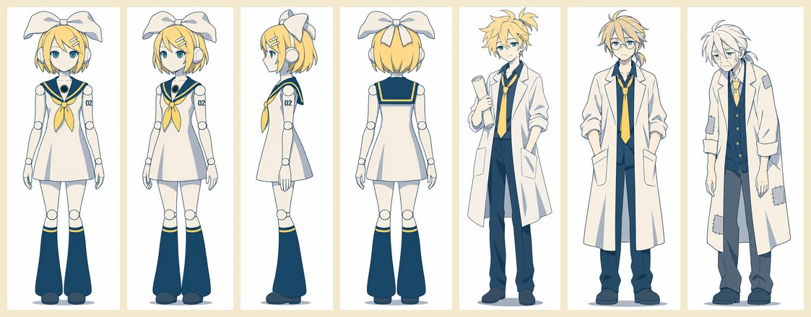
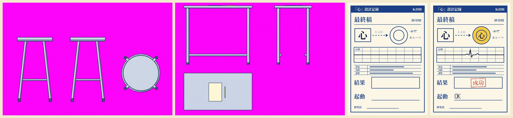

# 人物图怎么不出错

片中出现的 244 张人物卡片，全部是 Codex 带着设定图**一次整张生成**的。这篇讲三件事：先做设定图、整张生成不拼贴、看图验收。我们在这三件事上都走过弯路，最后留下的是下面这套做法。

## 1. 设定图先行：人物、道具、报告





设定图放在 [art/canon/](../art/canon/)：

| 文件 | 内容 |
|---|---|
| `rin_front.png` `rin_q34.png` `rin_side.png` `rin_side_r.png` `rin_back.png` `rin_expressions.png` | 铃：14 岁、152 cm、金色短发、白色大蝴蝶结、碧青色眼睛（#218EA3，带同心圆环）、发夹在她自己的左侧、“02”在左上臂、球形关节、深蓝靴 |
| `len_young.png` `len_front.png` `len_side_*.png` `len_back.png` `len_age08/20/45/78.png` `len_old.png` | 科学家：少年时金发小马尾、耳后夹一支铅笔、白大褂敞开、袖子卷到肘；以及各个年龄 |
| `prop_stool.png` `prop_stool_side.png` | 全片唯一的一把凳子：座面 0.35 m、高 0.65 m、四条外撇的腿 |
| `prop_desk*.png` | 桌子（桌高 0.95 m 版本是定稿；0.80 m 时坐在 0.65 m 的凳子上膝盖放不进去） |
| `prop_report.png` `prop_report_done.png` | 他最后那张报告：刚找到时和盖上「成功」之后 |

**道具也要设定图。** 凳子和桌子一开始只靠文字描述，结果每张图各画各的：腿数不同、桌面倾斜、桌上的纸也是歪的。后来先用脚本画出精确的几何引导图，再让 Codex 按片中画法上色，做成三视图，此后凡是画到凳子、桌子的卡片，都把道具设定图放在参考图里。报告也一样：哪一面朝观众、标题在哪一端、手怎么托，都以 `prop_report.png` 为准。

## 2. Codex 一次整张生成，不事后拼贴

出图用 [tools/gen.ps1](../tools/gen.ps1)：把提示词交给 Codex CLI，让它用内置的图像生成工具画一张图，参考图用 `-i` 附上。

```powershell
pwsh -NoProfile -File tools/gen.ps1 -PromptFile prompt.txt -OutPath art/v2/raw/kv_tie_a.png -Ref art/v2/raw/pad/g1_len_young.png,art/v2/raw/pad/g1_rin_front.png
```

### 规则

1. **一张卡 = 一次整张生成**。人物手里拿的、身上碰到的东西（凳子、桌子、纸、杯子、另一个人）都画在同一张图里，而且真的接触。不把设定图里凳子的像素贴回去，不把别张图的腿接过来，不把一个人整块贴进另一张图。
2. **参考图的顺序**：人设图 → 道具设定图（画到凳桌时）→ 本组已通过的一张好图（只管取景、大小和画法）。提示词里写明“设定图说了算；最后一张参考图只管取景，它的手和细节有错，不要照抄”（`SHEET_RULE`）。
3. **提示词 = 固定的几段 + 一句人话的动作**。固定段落见 [tools/g1_r9_prompts.py](../tools/g1_r9_prompts.py)：`RIN`（角色）、`STYLE`（画法）、`RIN_HANDS` / `LEN_HANDS`（手）、`NEVER`（禁止项）、`KEY`（纯品红底）、`TABLE`、`PAPER`。动作只写一句自然的表演，朝向用人话说清（“both shoes point forward, toward the desk”），不写像素、不写角度、不给骨架。完整的提示词见 [提示词](提示词.md)。
4. **背景一律纯品红 #FF00FF**，没有地面、没有投影、没有文字（铃左臂的“02”除外）。抠底见下文。
5. **同一组换张，用同一张母版原样重画、只改一处**（见 [连贯动作](连贯动作.md)）。各张独立生成，比例和细节对不上，换张时会像幻灯片。
6. 每张最多出三个候选。

### 为什么不拼贴

我们曾经为了让换张时凳子、桌子和她的身体“逐像素不动”，把设定图的凳桌像素贴回去、把别张的腿接上、把她整块贴进双人图。结果是抠图锯齿、残留底色、脚朝反了、手接不上。骨架和量值也一样：用它们逼姿势，画出来又僵又怪。《少女A》几乎不出错的原因正好相反：每张图都是一个完整自然的姿势，后期只抠底和清边。

## 3. 看图验收：gpt-6-astra 看单张原图

验收只问一件事：**观众一眼看过去怪不怪**。人体结构、手（左右手、手指数、是不是连着自己的手臂）、近大远小、接触点、纸的正反面、泪、凳桌，都按这个标准判断。

```powershell
pwsh -NoProfile -File tools/codex_review.ps1 -Images a.png,b.png -PromptFile tools/astra_look.md -OutFile review.md
```

- [tools/codex_review.ps1](../tools/codex_review.ps1) 让 Codex 用 gpt-6-astra（只读沙箱）看图，最后一条回复写进 `-OutFile`。看人物图用 [tools/astra_look.md](../tools/astra_look.md)，看成片帧用 [tools/astra_frame.md](../tools/astra_frame.md)。两份提示词都要求“不要量，只报看着不对的地方”，结论是「看着没问题」或问题清单。
- **给单张原图，一次最多三四张**。缩小的拼图它看不清，会全判没问题。
- 它指出问题，先自己对着图确认是否属实，属实就重出（最多再出两个候选）；连续两轮不过，就把最好的一张和它的意见一起交回，不无限重试。
- **它的结论也只是线索**：评级是模型做的，会错。放行前自己再看一遍原图，能用脚本核对的（尺寸、文件）用脚本核对。
- 另外自己把图合到片中的深蓝底（#1B3F86）上放大到 200% 看边缘：没有锯齿、没有品红残边、没有碎块。

**不用量数当门槛。** 早期我们按“上臂短 15%”“头大 6%”这类数字退图，结果把很多看着没问题的图判成有问题，也收下过数字合格、看着很怪的图。量值脚本可以帮忙定位问题，但只有“看上去”才是标准。

## 4. 烘焙成卡片

[src/bake_v2.py](../src/bake_v2.py) 读 [art/v2/sets.json](../art/v2/sets.json) 里每一组的定义，把原图烘成 `web/data/cards/v2_<名字>_lit_day.png`（另有阴影和夜间的三个版本，本片页面只读 `lit_day`，仓库里只带这一种），并把尺寸写进 `web/data/cards/v2.json`。

- **抠底**：[src/matte.py](../src/matte.py)。角色色板里没有一种颜色的红和蓝都比绿多，所以“品红度” `min(r, b) − g` 在人物上接近 0、在底色上接近 1，直接用它当透明度，并从边缘像素里把底色反解出去：细线不断，也没有色边。
- **只留主体**：`main_only()` 只保留最大的那块和贴着它的碎块（一张图里有两个人时，`sets.json` 里写 `keep_all`）。
- **瞳孔在阴影里保持青色**：阴影版本对全身乘冷色，只对瞳孔压暗不变色（`iris()`、`save4()`）。

### 坑：浅青色被当成纸

画里的纸是平涂的浅青色，烘焙时会把浅青色块换成米白纸色（`bake_v2.py` 第 149 行起）。问题是瞳孔的高光和泪也是浅青色，于是泪和眼睛被涂成了米白。两个开关解决它：

```python
if cfg.get("paper_min"):    # 只有纸那么大的色块才是纸：浅青的瞳孔、泪不是
    n_, lab_, st_, _ = cv2.connectedComponentsWithStats(cyan.astype(np.uint8), 8)
    cyan &= np.isin(lab_, [i for i in range(1, n_) if st_[i, cv2.CC_STAT_AREA] >= cfg["paper_min"]])
if cfg.get("keep_print"):   # 纸上印的细黑字：闭运算不能把它涂掉
    cyan &= rgb @ np.array([0.299, 0.587, 0.114], np.float32) > 0.62
```

带泪的组（`endt`、`tb` 等）在 `sets.json` 里都写了 `"paper_min": 3000`。

### 坑：并发烘焙会互相覆盖 `v2.json`

几组同时烘焙时，后写的会把先写的组的尺寸冲掉；渲染和烘焙同时进行，渲染会读到没写完的图（画面里人物的腿突然没了）。现在的规矩：**烘焙加锁、一次一组；烘完核对卡片 PNG 的尺寸等于 `v2.json` 里的 `px`；所有烘焙结束后再统一截帧。**

## 5. 定稿清单：先把所有图过完，再做视频

```powershell
node tools/audit_swaps.mjs                       # 记录每一帧画了哪些卡
python tools/used_cards_sheets.py out/used 440   # 按出场顺序拼出所有用到的卡
```

[tools/used_cards_sheets.py](../tools/used_cards_sheets.py) 按出场顺序列出片中实际画到的每一张卡（第三个参数可以再输出“一张一个文件”）。所有人物图在这份清单里都确认没问题、清单里没有“还打算改”的图之后，才开始截帧和合成。
