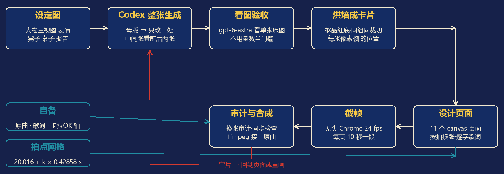

# 制作流程：从零到成片

**只想研究做法，读文档和代码就够了，不需要装任何东西。** 想自己跑起来，按下面的顺序。原环境是 Windows 11、Python 3.12、Node.js 24、Chrome、FFmpeg 8、PowerShell 7；人物图生成和看图用 Codex CLI。



## 0. 这套工程是什么

- **画面 = 11 个 canvas 页面**（`web/pages/*.js`），每页负责歌里的一段：`open → verse1 → ages → know → chorus1 → wonder → verse2 → say → thanks → finale → outro`。页面导出 `name, start, duration, prepare(), draw(c, t)`，`draw` 只依赖时间 `t`，所以任意一帧都能单独渲染。chorus1 和借用它舞台的几页（know、finale）用 three.js 摆三维空间里的卡片，其余是纯 2D。
- **人物 = 卡片**：Codex 生成、烘焙好的透明 PNG（`web/data/cards/`），尺寸数据在 `v2.json`。
- **公共的东西都在 `web/pages/kit.js`**：色板 `K`、拍长、`fig()` 画卡片、`column()/row()` 出字、`hit()` 落拍、`dayMark()`、`stamp()/press()`、`windFrame()`。
- **出图 → 烘焙 → 页面 → 截帧 → 合成** 是单向的；审片发现问题，回到页面改代码，或者回到出图重画。

## 1. 环境

```powershell
git clone https://github.com/RepressedAlliance/Fable5.2-Kokoro.git
cd Fable5.2-Kokoro
py -3.12 -m venv .venv
.venv\Scripts\python -m pip install -r requirements.txt
.venv\Scripts\python tools\fetch_fonts.py          # 10 个 OFL 字体 -> assets/fonts/（约 50 MB）
```

只预览页面的话，Python 只需要标准库（`web/serve.py`）；`numpy`、`opencv`、`pillow` 是烘焙和检查工具用的。

## 2. 自备音频和歌词

见 [input/README.md](../input/README.md)：

```powershell
# 放好 input/kokoro.wav 和 input/lyrics_lines.txt 之后
python tools\beat_grid.py input\kokoro.wav   # 第 0 拍应在 20.016 s 附近，否则先修正音频开头的静音
python src\apply_lyrics.py                   # -> web/data/lyrics.json
```

## 3. 渲染单帧

```powershell
python web\serve.py                          # 另开一个终端，保持运行；端口 8765
node tools\render.mjs "page=know&t=2" "page=finale&t=15"
```

图在 `frames/know_t2_00.png`、`frames/finale_t15_00.png`（`t` 是从这一页开头算的秒数）。想把帧存到别的盘：启动服务前设 `$env:KOKORO_FRAMES = 'D:\kokoro-frames'`。

也可以直接在浏览器里看：

- `http://localhost:8765/page.html?page=know&t=2`：渲染这一帧；
- `http://localhost:8765/page.html?page=know&play=1`：点一下画面，带声音实时播放这一页（需要 `input/kokoro.wav`）。

> 页面很吃内存：chorus1 一页要解码六十多张大图。机器内存紧的时候一次只开一个渲染。

## 4. 整页截帧

```powershell
python tools\capture_all.py                  # 全部 11 页；或者只写页名：python tools\capture_all.py know
```

每页切成 10 秒一段，各起一个无头 Chrome，每段 4 分钟超时、最多重试 4 次，结束时报告失败的段。整片约 6730 帧，每帧 PNG 约 0.4–2 MB。

## 5. 合成

```powershell
python src\assemble_pages.py out\kokoro.mp4 18        # crf 18；画面比声音早一帧
python tools\sync_check.py out\kokoro.mp4             # 画面的大变化落在拍上的比例
```

## 6. 检查（交片前）

```powershell
node tools\audit_swaps.mjs                   # 每页一个 Chrome 同时跑；内存紧就一页一页跑
python tools\audit_swaps.py                  # 停不满两拍的换张、A→B→A
python tools\used_cards_sheets.py out\used 440
pwsh -NoProfile -File tools\codex_review.ps1 -Images frames\know_t2_00.png -PromptFile tools\astra_frame.md -OutFile out\review.md
```

审片的要点见 [按拍对点](按拍对点.md) 和 [人物图怎么不出错](人物图怎么不出错.md)。

## 7. 重新生成或烘焙人物图（可选）

仓库只带**成片用到的卡片**（烘焙后的 PNG），不带 Codex 的原图和落选候选（几千张、7 GB）。想用同样的方法画你自己的图：

```powershell
# 1. 设定图：art/canon/ 里的图就是样板；先把它们垫成模型常用的画幅
python tools\pad_ref.py art\canon\rin_front.png art\v2\raw\pad\g1_rin_front.png
# 2. 写提示词、出图（固定段落 + 一句动作；见 docs/提示词.md）
pwsh -NoProfile -File tools\gen.ps1 -PromptFile my_prompt.txt -OutPath art\v2\raw\my_card_a.png -Ref art\v2\raw\pad\g1_rin_front.png
# 3. 看图验收
pwsh -NoProfile -File tools\codex_review.ps1 -Images art\v2\raw\my_card_a.png -PromptFile tools\astra_look.md -OutFile out\look.md
# 4. 在 art/v2/sets.json 里加一组，烘焙
python src\bake_v2.py mygroup                # -> web/data/cards/v2_<名字>_*.png 和 v2.json
```

`tools/g1_r9_prompts.py`、`tools/w1_wind_prompts.py`、`tools/w2_endt.py`、`tools/v2_edits.ps1` 是成片时实际用的出图脚本，它们引用的原图不在仓库里，当作写法参考来读；要跑就把母版路径换成你自己的图。

## 8. 时间参考

在 RTX 4060 Laptop、16 GB 内存的笔记本上：单帧 1–3 秒（含启动 Chrome）；整页截帧几分钟到十几分钟一页；合成一两分钟。Codex 出一张图通常 1–2 分钟。

## 这套工程不是模板

页面、拍号、卡片名都是为《ココロ》这一首歌写的。换一首歌，要重新量拍点、对歌词、设计页面和画人物；能直接拿走的是方法和工具：`kit.js` 的出字和换张、`windFrame` 循环、`bake_v2.py` 的烘焙、`render.mjs` 的无头渲染、`audit_swaps` 的换张审计、`finale_heart.js` 的“量字铺纸”。
