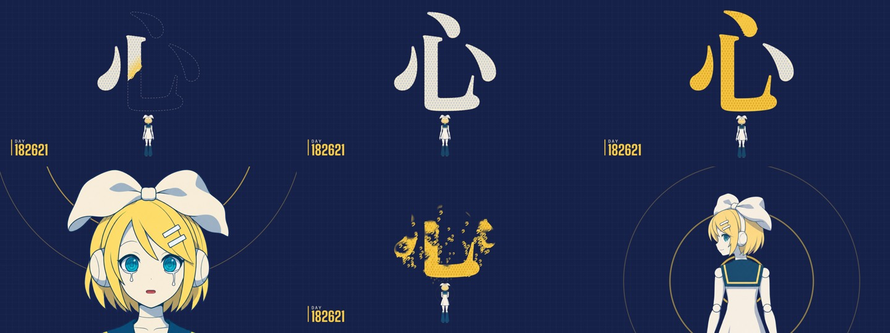

# 歌声写成「心」

尾声约 3:54–4:13。铃站在画面正下方，头顶的「心」随着唱出的音节写成，再化为「ラ」流进她的身体。

实现在 [finale_ra.js](../web/pages/finale_ra.js)，由 [finale.js](../web/pages/finale.js) 的 `raStage()` 调度。

- **笔顺**：把「心」的字形栅格化，取出四个连通的笔画分量，按笔顺排序。对每一笔，从落笔处沿笔画形状计算像素的测地距离，用距离控制墨迹出现的先后。
- **跟着歌声落笔**：第一组唱音驱动书写，四笔写完后显示完整字形。第二组的前四个音依次把四笔点成黄色，最后一个长音切到她的脸。音节的起点由 `LA` 和 `LU` 记录。
- **把「ラ」印进墨里**：把小字按行排布，用 Canvas 的 `source-atop` 将其限制在现有墨迹中。
- **流入身体**：从字的上端开始，以平滑波纹决定像素消散次序。每个飞出的「ラ」沿二次贝塞尔曲线飞向她。八音盒响起时，她回头。

## 上一版

旧版让图纸从两侧飞来聚成字，再翻黄、散去。纸片堆出的字形边缘碎，飞纸分散了视觉中心，当时这里也漏了尾唱歌词。v12 换成固定对称构图，用歌声带动每一笔。旧做法仍可在 [finale_heart.js](../web/pages/finale_heart.js) 里查看。
