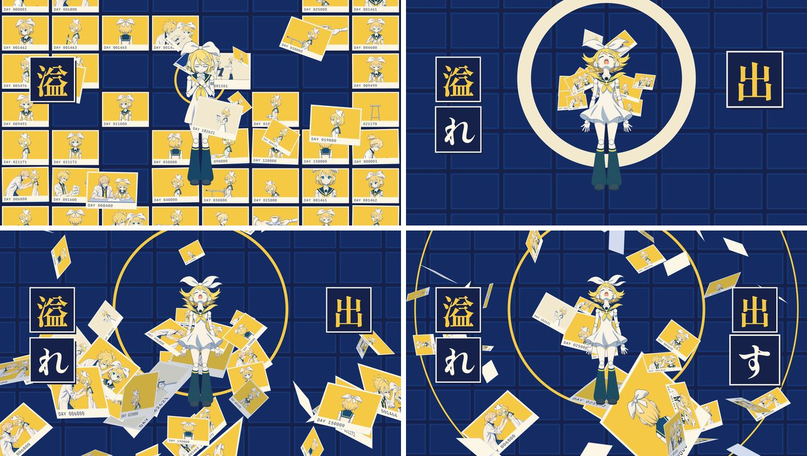

# 记忆涌出：「溢れ出す」

verse2 的最后一镜（k391.5–k401.5，约 187.8–192.1 s）。前面几镜里，她身后是一整面“回忆墙”：一格一张，每张是他们一起度过的某一天。到「溢れ出す」这一句：

1. **吸入**（k391.5–395）：墙上亮着的照片一张接一张离开墙面，旋转着被吸进她胸口那个空的圆环。她双手按着胸口、低头、闭眼、流着泪（`ov_hold`）。墙上留下一格格空的深色框。镜头慢慢推近。
2. **涌出**（k395，「出」）：她猛地向后张开双臂、仰起头，头发在风里飘（`ov_burst_w1…w8`，风循环）；照片从圆环里喷涌而出，向外、绕圈、朝镜头飞，越近越大，有的从镜头旁边擦过。一圈纸环从她胸口扩散出去。镜头往后拉。

代码：[web/pages/verse2_overflow.js](../web/pages/verse2_overflow.js)（`prepareOverflow()`、`drawOverflow()`），墙和照片的画法来自 [web/pages/wonder.js](../web/pages/wonder.js)（`sheets()`）。

## 1. 每张照片都是墙上那一格本身

飞起来的不是新画的纸片，而是**墙上那一格当时的样子**：`bake(i, j)` 把 wonder 页画墙的函数在一块离屏画布上画一遍，截下第 (i, j) 格，缓存成 534 / 267 / 134 / 67 px 四档（`mipsOf()`），再用正片叠底做出一份“背光面”。飞行时按它在画面上的大小挑最合适的一档，太小的纸不会闪烁，太大的纸不会糊。

每张照片在空间里是一张有正反面的卡片（`drawCard()`）：

- 位置和三轴旋转决定它的四个角，透视投影到画面上（镜头在 z = 1500 处）；
- 朝着镜头的一面贴照片，背面是空白的纸；
- 法线朝光的一面用亮的那档，背光用暗的那档，只有两档硬边；
- 侧对镜头只剩一根线时不画；太靠近镜头时不画（避免一张纸糊满画面）；
- 每一帧按深度从远到近画：在她身后的纸画在她后面。

## 2. 吸入：近的先走，但全墙都在开洞

每一格离开的时间由“离她的距离”和一个随机数各占一半排序（`RANK`），均匀铺满到「出」之前的 2.75 拍：离她近的倾向先走，但洞会在整面墙上陆续出现，不是一圈圈往里剥。离开前先在钉子上抖一下。

飞行路径（`suckAt()`）：半径按 `q^1.7` 收向圆环，同时绕圆环转过 0.9–1.7 弧度；先离开墙面朝镜头凸出来，再收进去；越近越小，进圆环时缩到原来的 4%。

## 3. 涌出：像喷泉，不穿过她

150 张照片从「出」开始发射，大部分集中在开头（发射时间 `te = kt(395) + 6.1 × PB × u²`）。每张随机分成三类（`newOut()`）：

- **往后飞**（约 36%）：飞向她身后，画在她后面；
- **擦过镜头**（约 9%）：朝镜头冲，从画面边上擦过去；
- **向外**：向两侧斜上方散开，半径按指数曲线张开，再加一点下坠（`+ 90 τ²`）。

## 4. 不让任何一张纸挡住她的脸

这一镜的硬规则：**纸不穿过她的脸和蝴蝶结**。办法是在准备阶段把每张纸的整条轨迹先算一遍：

- 吸入时，若轨迹会经过她的脸（`overFace()`），这张纸改成从她身后走；
- 涌出时，在她前面出现的纸要先“从她身后钻出来”：在离开她身体的轮廓之前，它都画在她后面（`fr`）；离开之后，只要轨迹会再碰到她的身体或脸，就换一组随机数重来（最多 6 次），还不行就改成往后飞。

脸的位置不是手填的：圆环在卡片上的像素位置记在 `RING`（或 `v2.json`），按“脸的中心在圆环上方 0.15 m、蝴蝶结在 0.36 m”换算到画面上（`placeOf()`）。

## 5. 字和镜头

- 「溢れ / 出す」是两列方块字，分在她左右两侧，一个字一个字唱到才落下，不进她的轮廓。
- 镜头：吸入时缓推 12%，「出」之后先快速拉开，再慢慢继续拉（`zoomOf()`）。

## 想拿走

“先算完整条轨迹，再决定画在前还是后”这个办法，适合任何“很多东西从人物身上飞出来”的镜头：只要有人物身体和脸的区域，就能保证没有一张东西挡脸，又不会全躲到身后显得假。
