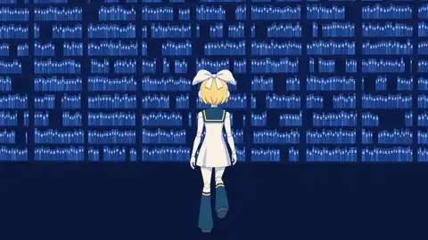
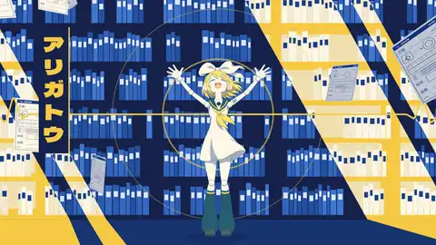
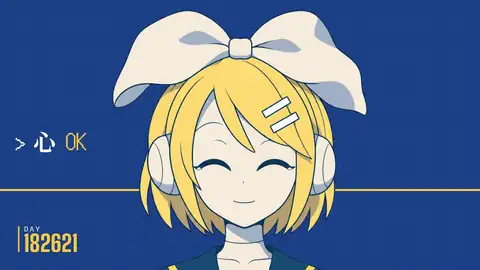
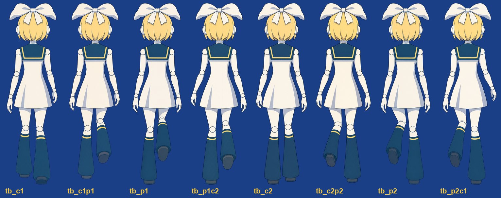
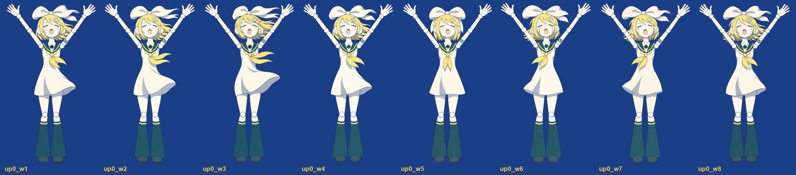
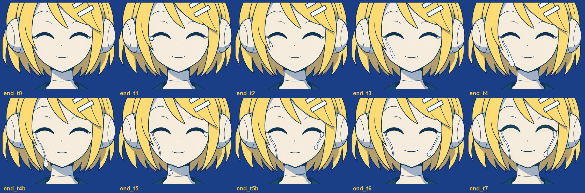
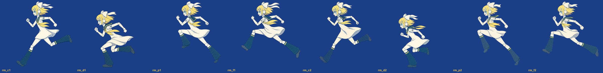
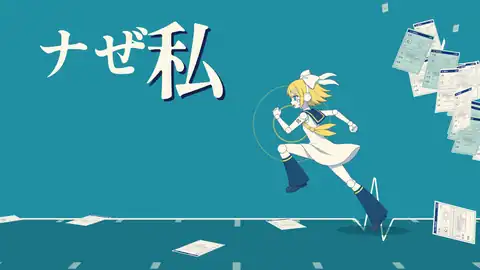

# 连贯动作：画出来的循环帧

片子里人物的“动”全部来自**画出来的图**：走路、奔跑、风吹头发、结尾的一滴泪，每一帧都是 Codex 整张画的一张人物图。代码只负责三件事：让同一组的图逐像素对齐、在正确的时刻换下一张、把人放在场景里正确的位置。代码不扭曲、不抖动、不缩放人物，也不往脸上画泪滴。

<p align="center">  </p>

这一篇讲三种循环怎么画、怎么对齐、怎么播。它们的做法相同，只是“动的部位”和“播放方式”不同：

| 循环 | 卡片组 | 张数 | 动的部位 | 播放 | 页面 |
|---|---|---|---|---|---|
| 背对镜头走路 | `tb` | 8（4 关键 + 4 中间） | 腿、手臂 | 每张 1/4 拍，两拍一圈（一拍一步） | [know.js](../web/pages/know.js) `w1()` |
| 侧面奔跑 | `rm` | 8 | 全身 | 同上，落脚卡在半拍上 | [chorus1.js](../web/pages/chorus1.js) `runner()` |
| 风 | `up0`、`up_a`、`cd0`、`cd_a`、`cb_out`、`ov_burst` 的 `_w1…_w8` | 每组 8（4 关键 + 4 中间） | 发梢、蝴蝶结、领巾、裙摆 | 每张 3 帧，一秒一圈，按歌曲帧号连续 | [kit.js](../web/pages/kit.js) `windFrame()` |
| 结尾的泪 | `endt` 的 `end_t0…t7`（含 `t4b`、`t5b`） | 10 | 泪 | 一次性，按八音盒的音换张 | [outro.js](../web/pages/outro.js) `endCard()` |

## 1. 先有一张母版

每组循环都从一张**已经通过验收的母版**开始（怎么画母版、怎么验收见 [人物图怎么不出错](人物图怎么不出错.md)）。后面所有帧都以母版为第一张参考图，提示词的开头永远是同一句“把第一张图原样重画”：

> Redraw the FIRST attached image EXACTLY, line for line, as if traced: the same android girl, the same front view, the same picture size and framing, the same SIZE and POSITION of her head and body in the picture … nothing of her body moves, nothing is scaled, nothing turns.

然后只写**这一帧和母版不同的那一处**。风的循环把“允许动的东西”写成一个清单，清单外的一律不许动（[tools/w1_wind_prompts.py](../tools/w1_wind_prompts.py) 的 `WIND_ONLY`）：

> ONLY THE WIND CHANGES, and the wind moves only these: the ends of her hair …, the two loops and the hanging tail ends of the big white bow (the knot stays in place …), the two tails of the yellow neckerchief (the knot stays), and the hem of the white dress below the hips.

提示词最后还要钉住画幅：“exactly the same pixel size and shape as the first attached image (W × H pixels); do not change the canvas, do not zoom in or out”。模型换了画幅，比例往往跟着变；参考图事先用 [tools/pad_ref.py](../tools/pad_ref.py) 垫成模型常用的画幅（2:3、1:2…），烘焙时再原样裁回去（`src/bake_v2.py` 里的 `pad_ref.canvas`）。

## 2. 关键张和中间张

**关键张**各写一个相位，都只参考母版。风的四个关键相位（`KEY`）：

| 相位 | 写法（摘要） |
|---|---|
| w1 | 微风：所有会动的东西稍微偏向画面右边，和母版差不多 |
| w3 | 阵风最强：发梢明显吹向右边，比母版多出约半个头宽；蝴蝶结右边的环和带子平着飘出去；裙摆右边鼓起、左边贴着腿 |
| w5 | 风过去了，回摆经过中间：发梢几乎垂直、两边对称 |
| w7 | 小幅反向：稍微偏向左边，明显比阵风小 |

**中间张**用三张参考图：母版、它前一张、它后一张，提示词只说“正好在这两张的中间”（`INB_TEXT`）：

> THIS MOMENT: exactly half way between the second and the third attached images. Every hair lock, bow loop, neckerchief tail and the dress hem is drawn in the position half way between where it is in those two drawings - the same shapes, part way along their swing; nothing new appears.

走路也一样。`tb` 组先画三张关键张（`tb_c1` 左脚着地、`tb_p1` 右腿经过、`tb_p2` 左腿经过），`tb_c2` 由 `tb_p1`、`tb_p2` 两张推出来，四张中间张 `tb_c1p1`、`tb_p1c2`、`tb_c2p2`、`tb_p2c1` 各用相邻的两张作参考。写法见 [tools/v2_edits.ps1](../tools/v2_edits.ps1) 的 `tb` 一节：每张写一句人话的动作，“CONTACT: her LEFT leg has stepped forward … in a SHORT step; both legs keep exactly the length they have in the first image”。





> 只画两张来回切（A→B→A）会被看成“鬼畜”；为了避免鬼畜又改得太保守，动作就看不出来了。现在的标准是：**至少四个相位加中间张，一圈回到起点是顺的，动作幅度要看得出来。**

## 3. 对齐：同一套缩放平移，不变形

模型画出来的每一张，身体总会差一两个像素。对齐只允许**一个统一的缩放加平移**，不做局部变形，否则线条会被拉坏。

- **风的循环**：[tools/w1_align.py](../tools/w1_align.py) 只用不该动的部分求对齐。先只看膝盖以下（靴子和小腿），用 OpenCV 的 ECC 求一个仿射；再把整个人物里差得多的地方（头发、蝴蝶结、领巾、裙摆）和黄色部分剔掉，用剩下的身体再求一遍；最后把仿射收成“等比缩放 + 平移”。脚本会打印 `sx/sy`（离 1 太远说明被画胖或画瘦了，这张要重画）和身体轮廓的差异百分比，并输出一张叠图 `ov_*.jpg` 给人看。
- **结尾的泪**：[tools/w2_endt.py](../tools/w2_endt.py) 每一帧以**上一帧**为底重画。对齐只用头、蝴蝶结、耳机这些不动的部分（`register()`，由粗到细三级 ECC），再把颜色线性拟合回母版（`colour_fit()`）。然后只把“这一帧和上一帧在脸上不同的地方”换成新图（`changed_from()` 加上泪的路径），头发、蝴蝶结、耳机永远来自同一张底图。这是《少女A》结尾 `build_end.py` 的做法：泪是 Codex 画的像素，代码只决定哪一块用新画的那张。



## 4. 烘焙：整组共用一个裁切框

[src/bake_v2.py](../src/bake_v2.py) 把一组图烘成卡片（`web/data/cards/v2_<名字>_lit_day.png`），并在 `web/data/cards/v2.json` 里记下这组的尺寸：

- **一组只有一个裁切框**：取组内所有图的并集，所以同组的图叠在一起时，不该动的地方逐像素重合；
- `mpp`：每像素多少米。站立的图按“头顶到鞋底 = 身高”算（铃 1.52 m），特写按头发高度和设定图比，也可以直接给数或借用别的组（`mpp_of`）；
- `ax`：母版的脚在卡片中心左右多少米；`ground`：每张图着地的鞋底位置；`low`：每张图最低点离卡片底边多高（走路的着地张会比经过张低一点，页面用它把卡片往下放）；
- `frame_of`：**让一组新图用另一组的裁切框和母版**。`endt` 组写了 `"frame_of": "en"`，所以十张泪的卡片和原来那张定格笑脸 `en_c` 的尺寸、位置完全一样，页面里只要把卡片名换掉，位置和缩放一行都不用改。
- 每次烘焙还会输出一张“洋葱皮”对照图（`work/look/v2_<组>_onion.jpg`）：每张图和母版各半透明叠在一起，不该动的地方应该完全重合。

## 5. 播放

### 走路（`know.js`）

```js
const WALK = ['tb_c1', 'tb_c1p1', 'tb_p1', 'tb_p1c2', 'tb_c2', 'tb_c2p2', 'tb_p2', 'tb_p2c1'];
const wk = WALK[((Math.floor((kb - 128) * 4 + 1e-6) % 8) + 8) % 8];   // kb：歌曲的第几拍
G.setHer(wk, 0, -(TB_LOW[wk] ?? 0), zh);                              // 用 low 把着地张放低一点，脚踩在地上
```

换张**按拍算**，不按帧算：每 1/4 拍换一张，两拍一圈，正好一拍一步。她在三维场景里是一块贴着卡片的平面（chorus1 的舞台），向纵深走，镜头跟着往前推（`zh = 6 * (1 - u)`）。后来全片的动态都以这一镜为标准。

### 奔跑（`chorus1.js`）

和走路同样是八帧、每张 1/4 拍，但多了两条：

1. **落脚卡在耳朵听到的“咚”上**。这一段的底鼓和人声落在半拍上（k + 0.5），所以着地张 `rm_c1`/`rm_c2` 落在 k = 205.5, 206.5 … 223.5，而且比声音早一帧出现（`LEAD = 1/24 s`，见 [按拍对点](按拍对点.md)）。一拍一步就是每分钟 140 步，等于歌的 140 BPM。
2. **地面速度取自图本身**：`SPEED = 2 × (rm_p1 着地点 − rm_c1 着地点)`（`v2.json` 的 `ground`）。这样着地的那只脚换张时回到地上的同一点，不会一步一步越滑越远。每张图停留的两三帧里脚会相对地面往前蹭一点，换张时又回到原位；彻底消除要每圈画 12–16 张。

```js
const g = V2.rm.ground, a = g.rm_c1, p = g.rm_p1;
const v = 2 * (Math.max(...p) - Math.min(...a)); if (v > 1.2 && v < 4) SPEED = v;
```



<p align="center"></p>

### 风（`kit.js` 的 `windFrame`）

```js
export const WIND8 = 8;
export const windNames = base => Array.from({ length: WIND8 }, (_, i) => `${base}_w${i + 1}`);
export function windFrame(base, T, has = n => !!IM[n]) {
  const all = windNames(base); if (!all.every(has)) return base;     // 缺一张就整组退回母版，不让母版和循环帧混着闪
  return all[Math.floor(Math.round(T * 24) / 3) % WIND8];             // 每张 3 帧，按歌曲时间取帧号
}
```

关键是**按歌曲时间取帧号**，不是按镜头或页面里的时间：风在切镜、换页、换姿势的时候不会断，也不会每拍从头开始。页面里在姿势表的卡片名后面加 `~` 表示“这个姿势用风循环”，例如 verse2 的 `UP = [[0, 'up_a~'], [395.5, 'up_b'], [397.5, 'up0~']]`。

### 结尾的泪（`outro.js`）

结尾的泪不循环，是一条单向的线：t0 → t1 → t2 → t3 → t4 → t4b → t5 → t5b → t6 → t7，直接换张、不做淡化。每张停多久跟着尾奏的八音盒音走（频谱通量量出来的音头：273.76、274.31、275.01、276.07 s），往下滑的几张每张 0.5–0.7 秒；下巴下方正在落的那一滴（t5）只停 6 帧，读成“正在落下”；最后一张 t7 和 DAY 182621 → 182622 的翻牌同时出现，一直停到片尾。

## 6. 检查

- **连起来看**：把一圈按顺序拼成一条（每 3 帧一格，一行一圈），看身体抖不抖、动的部分是不是同一个方向连续地走。
- **看单张**：每张都给 gpt-6-astra 看原图（[tools/codex_review.ps1](../tools/codex_review.ps1)），见 [人物图怎么不出错](人物图怎么不出错.md)。
- **换张审计**：[tools/audit_swaps.py](../tools/audit_swaps.py) 会把循环帧标成“过短”（3 帧），这是豁免项；它真正要抓的是 A→B→A 和停不满两拍的普通换张（见 [按拍对点](按拍对点.md)）。

## 已知的不足

- 风循环每圈有一处“吹到最大 → 下一张就几乎回平”（例如 `up0` 的 w3→w4），八分之一秒里收回去一大截。补一张回落的中间张、把循环改成 10 帧会更顺，页面只需改 `WIND8`。
- 风循环各帧身体仍有约 1% 的出入；过渡姿势（`up_b`、`cb_up`）没有风循环，停着的两拍头发是静的。
- `end_t5` 那滴正在落下的泪，单帧看像贴在颈圈上；动起来只闪 6 帧，看不出来。根治要重画这一张，让泪离开颈圈、带一点下落的拖影。
